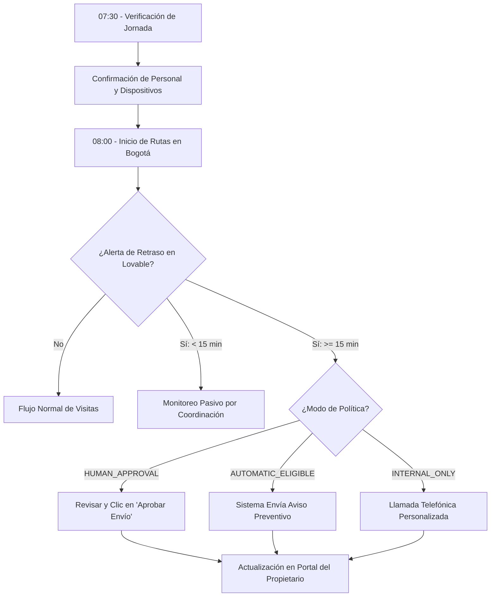

# VET FREEDOM OS — DISPATCH & TRACKING RUNBOOK
## Manual Operativo de Despacho en Vivo, Gestión de Retrasos y Contingencias
### Versión 15B.0 — Procedimientos para Coordinación y Dirección Médica

---

## 1. Roles y Responsabilidades
- **Director Médico (Dr. Luis Eduardo Ríos)**: Autoridad final en decisiones de agenda, reasignación médica, reprogramación de pacientes críticos y autorización de transición de modo seguro a producción.
- **Coordinador de Operaciones / Despacho**: Supervisión continua del panel de control de Lovable, atención de alertas internas de retraso, comunicación telefónica prioritaria y aprobación de despachos en modo `HUMAN_APPROVAL`.
- **Médico Veterinario de Campo**: Registro puntual de eventos de visita (`EN_ROUTE`, `ARRIVED`, `SERVICE_STARTED`, `SERVICE_FINISHED`) y reporte proactivo de extensiones de consulta mediante la app móvil.

---

## 2. Flujo Diario de Operación

---

## 3. Matriz de Procedimientos ante Retrasos

### Procedimiento P-01: Retraso Menor (10 a 14 minutos)
1. El panel de Lovable resalta la parada en amarillo suave.
2. No se envía mensaje al propietario para no generar alarma innecesaria.
3. El sistema monitorea si el buffer administrativo entre citas absorbe la diferencia.

### Procedimiento P-02: Retraso Moderado (15 a 29 minutos)
1. El panel emite una alerta auditiva/visual en la mesa de coordinación.
2. Si la política está en `HUMAN_APPROVAL`:
   - El coordinador valida si el paciente subsiguiente tiene restricciones de horario.
   - Si no hay inconveniente, presiona **"Autorizar Notificación"**.
   - El sistema despacha el mensaje predeterminado por WhatsApp con el enlace de seguimiento.
3. Si la política está en `AUTOMATIC_ELIGIBLE`:
   - El motor despacha automáticamente una vez cumplidas las 2 predicciones consecutivas.

### Procedimiento P-03: Retraso Severo ($\ge$ 30 minutos) o Cita Protegida
1. Alerta crítica roja en pantalla.
2. El coordinador se comunica inmediatamente por llamada telefónica con la familia.
3. Se evalúa con el Dr. Ríos la opción de:
   - Dividir la ruta y reasignar la cita a un médico veterinario de apoyo.
   - O reprogramar la visita al final de la tarde con el consentimiento del propietario.

---

## 4. Gestión de Dispositivos y Telemetría Offline
Si un veterinario pierde cobertura de datos móviles en zonas con baja señal:
1. El sistema marca el estado del dispositivo como `STALE` tras 5 minutos sin reportes.
2. La confianza de ETA conmuta a `LOW`.
3. Se bloquea cualquier notificación automática hacia el cliente hasta restablecer señal válida.
4. El teléfono almacena localmente los eventos en caché (IndexedDB / SQLite local) y los retransmite en ráfaga idempotente al recuperar conexión mediante el RPC `ingest_location_observation()`.

---

## 5. Checklist de Activación en Producción (Salida de Modo Seguro)
Actualmente, el sistema opera con `send_enabled: false` y políticas en modo `INTERNAL_ONLY`. Para activar despachos reales a clientes:

- [ ] Verificación de credenciales de WhatsApp Business Platform autorizadas en n8n.
- [ ] Plantillas de mensaje aprobadas por Meta para Vet Life.
- [ ] Consentimiento explícito de comunicaciones (Habeas Data) registrado en fichas de propietarios.
- [ ] Al menos 2 semanas de pruebas de campo sin falsos positivos en cálculo de ETA.
- [ ] Aprobación formal y firmada por el Dr. Luis Eduardo Ríos.
- [ ] Actualización del registro en `delay_notification_policies` cambiando `mode` a `HUMAN_APPROVAL`.
