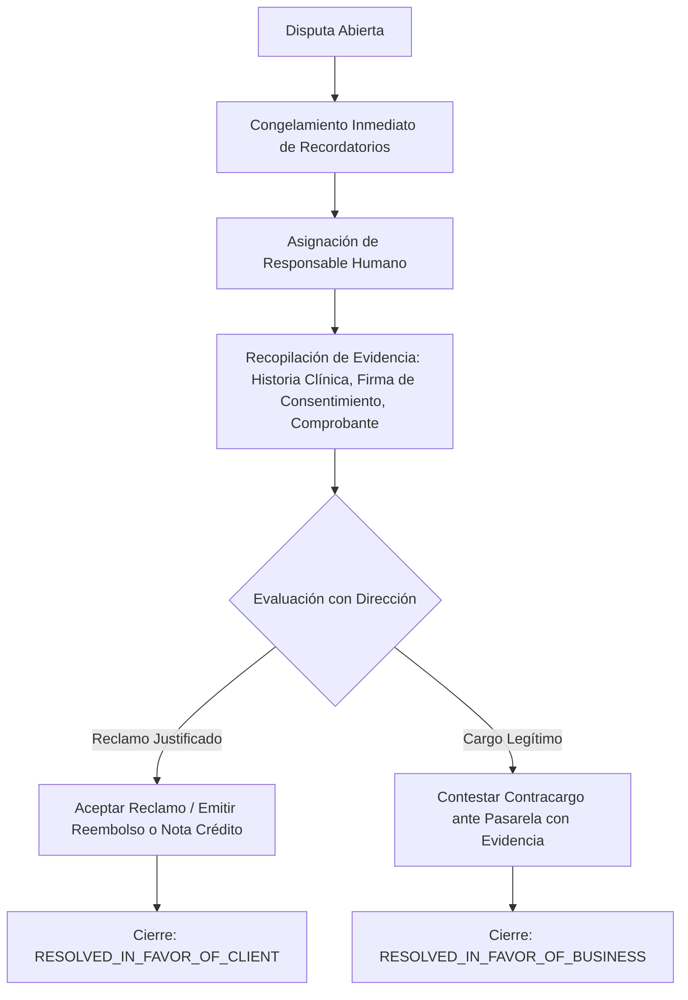

# VET FREEDOM OS — DISPUTE HANDLING RUNBOOK
## Protocolo Operativo para Gestión de Disputas, Contracargos y Reclamaciones
**Módulo:** VET-CORE-14 | FINANCIAL NOTIFICATIONS  
**Dirección Médica:** Dr. Luis Eduardo Ríos  
**Dirección Estratégica:** Alpha Vision Method  

---

## 1. Detección y Registro de Disputas

Una disputa financiera puede originarse por dos canales:
1. **Canal Bancario / Pasarela:** Notificación de contracargo por desconocimiento de compra en tarjeta de crédito.
2. **Canal Directo (Tutor):** El cliente manifiesta inconformidad con el cobro o solicita aclaración por presunto cobro indebido o duplicado.

Al registrarse en `financial_disputes`:
- El estado pasa a `OPENED`.
- La solicitud de pago vinculada se congela en `UNDER_DISPUTE`.
- Se genera una alerta de alta prioridad a la Coordinación de Experiencia y Dirección Financiera.

---

## 2. Flujo de Investigación y Resolución Humana

### Prohibición Categórica:
La Inteligencia Artificial tiene **prohibido de manera absoluta resolver, cerrar o emitir dictámenes sobre disputas financieras**. Toda decisión debe ser suscrita por un responsable humano con nombre y cargo.
