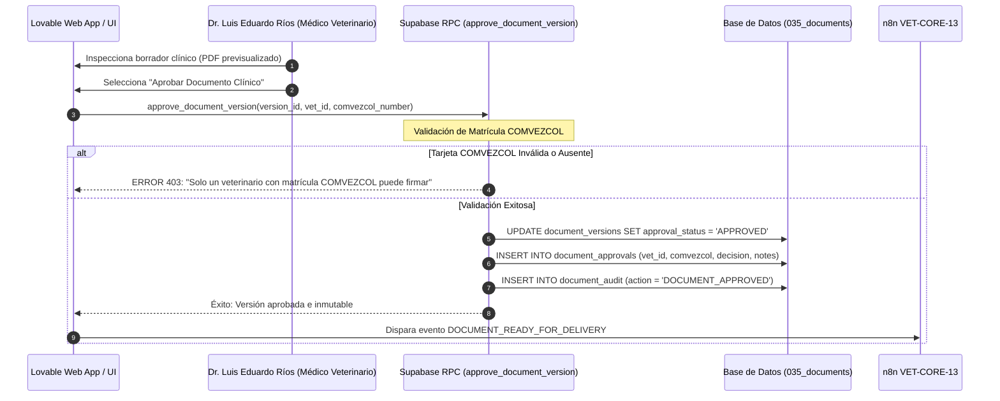

# VET FREEDOM OS — DOCUMENT APPROVAL PROTOCOL
## Procedimiento Operativo Estándar (SOP): Firma, Verificación Profesional COMVEZCOL y Aprobación Clínica

**Proyecto:** VET FREEDOM OS  
**Módulo:** `VET-CORE-13`  
**Responsable Médico:** Dr. Luis Eduardo Ríos  
**Marco Regulatorio:** Ley 576 de 2000 (Código de Ética Médica Veterinaria de Colombia), Decreto 2350 de 1971

---

## 1. Principio Fundamental: Invariante del Profesional Titulado

En la República de Colombia, la formulación de medicamentos, la expedición de certificados de salud o vacunación, el diagnóstico clínico y la ordenación de procedimientos médicos veterinarios constituyen actos privativos de los profesionales legalmente facultados con matrícula profesional vigente expedida por el **Consejo Profesional de Medicina Veterinaria y de Zootecnia de Colombia (COMVEZCOL)**.

**Invariante del Sistema:**
> Ninguna inteligencia artificial, asistente automatizado, estudiante o personal administrativo puede aprobar o firmar documentos clínicos. Cualquier intento de emisión de un documento sin matrícula profesional válida de COMVEZCOL provocará una excepción bloqueante en la base de datos y detendrá la cadena de entrega en n8n.

---

## 2. Flujo Operativo de Revisión y Firma

---

## 3. Tipos de Documentos y Exigencia de Matrícula

| Tipo de Documento | Requiere COMVEZCOL | Puede ser Aprobado por Asistente | Justificación Legal |
| :--- | :---: | :---: | :--- |
| `CLINICAL_REPORT_APPROVED` | **SÍ** | NO | Diagnóstico clínico y evolución médica (Ley 576/00 Art. 33) |
| `REFERRAL_LETTER` | **SÍ** | NO | Prescripción de interconsulta especializada |
| `PRESCRIPTION_ORDER` | **SÍ** | NO | Formulación de fármacos de control o venta bajo fórmula |
| `VACCINATION_CERTIFICATE` | **SÍ** | NO | Fe pública sobre inmunización biológica animal |
| `LAB_RESULT` (Validación) | **SÍ** | NO | Interpretación del cuadro hematológico/bioquímico |
| `INVOICE` / `RECEIPT` | NO | **SÍ** | Documento puramente contable/administrativo |
| `CARE_SHEET_GUIDE` | NO | **SÍ** | Guía pedagógica general de cuidados en casa |

---

## 4. Auditoría de Firmas y Sello Temporal

Al ejecutarse `approve_document_version`:
1. Se captura la tarjeta profesional provista (`approver_comvezcol`).
2. Se inscribe la estampa temporal precisa con microsegundos (`approved_at = now()`).
3. El estado de la versión cambia a `APPROVED` y la propiedad `is_active` se establece en `true`.
4. El archivo físico en storage queda sellado criptográficamente: cualquier alteración de bytes posterior invalidará el hash SHA-256 e impedirá el despacho seguro.
