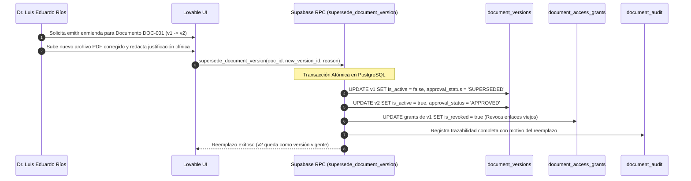

# VET FREEDOM OS — DOCUMENT REPLACEMENT & VERSION SUPERSEDING
## Procedimiento Operativo Estándar (SOP): Enmiendas Clínicas, Reemplazo de Versiones e Inmutabilidad Histórica

**Proyecto:** VET FREEDOM OS  
**Módulo:** `VET-CORE-13`  
**Dirección Médica:** Dr. Luis Eduardo Ríos  
**Estándar Médico-Legal:** Inmutabilidad de la Historia Clínica (Ley 576 de 2000 Art. 34)

---

## 1. El Principio de No Alteración Retrospectiva

En medicina veterinaria, un registro clínico emitido y firmado **nunca debe ser sobreescrito o editado destructivamente**. Si se detecta un error tipográfico en una dosis, una aclaración en un examen ecográfico o un cambio en la evolución del paciente:
- La versión original (`v1`) **debe permanecer intacta y consultable en auditoría**.
- Se debe emitir una **nueva versión formal (`v2`)**, con su propio hash SHA-256, justificación clínica del cambio y nueva firma profesional COMVEZCOL del Dr. Luis Ríos.
- La versión previa adquiere el estado `SUPERSEDED` (reemplazada), perdiendo su condición de documento activo para entrega.

---

## 2. Flujo de Superseding (Reemplazo Controlado)



---

## 3. Implementación en Base de Datos

El procedimiento `supersede_document_version` asegura que el reemplazo no deje estados huérfanos ni enlaces obsoletos funcionando:

```sql
CREATE OR REPLACE FUNCTION public.supersede_document_version(
    p_document_id UUID,
    p_new_version_id UUID,
    p_reason TEXT
)
RETURNS JSONB
LANGUAGE plpgsql
SECURITY DEFINER
SET search_path = public
AS $$
DECLARE
    v_old_version RECORD;
BEGIN
    -- 1. Localizar la versión activa actual
    SELECT * INTO v_old_version
    FROM document_versions
    WHERE document_id = p_document_id AND is_active = true;

    IF NOT FOUND THEN
        RETURN jsonb_build_object('success', false, 'error', 'ACTIVE_VERSION_NOT_FOUND');
    END IF;

    -- 2. Marcar versión anterior como SUPERSEDED
    UPDATE document_versions
    SET is_active = false,
        approval_status = 'SUPERSEDED',
        updated_at = now()
    WHERE id = v_old_version.id;

    -- 3. Activar nueva versión
    UPDATE document_versions
    SET is_active = true,
        updated_at = now()
    WHERE id = p_new_version_id;

    -- 4. Actualizar puntero en la tabla documents
    UPDATE documents
    SET current_version_id = p_new_version_id,
        updated_at = now()
    WHERE id = p_document_id;

    -- 5. Revocar enlaces y tokens emitidos para la versión vieja
    UPDATE document_access_grants
    SET is_revoked = true,
        updated_at = now()
    WHERE version_id = v_old_version.id;

    -- 6. Auditoría inmutable
    INSERT INTO document_audit (
        document_id,
        action,
        previous_state,
        new_state,
        performed_by,
        performed_at
    ) VALUES (
        p_document_id,
        'DOCUMENT_VERSION_SUPERSEDED',
        jsonb_build_object('superseded_version_id', v_old_version.id, 'version_number', v_old_version.version_number),
        jsonb_build_object('active_version_id', p_new_version_id, 'reason', p_reason),
        auth.uid(),
        now()
    );

    RETURN jsonb_build_object(
        'success', true,
        'document_id', p_document_id,
        'superseded_version_id', v_old_version.id,
        'new_version_id', p_new_version_id,
        'superseded_at', now()
    );
END;
$$;
```

---

## 4. Experiencia del Tutor y Notificación de Actualización

Cuando un documento es reemplazado:
1. El portal de Lovable muestra una etiqueta distintiva: `Versión Actualizada (v2)`.
2. Si el tutor intenta ingresar mediante un enlace antiguo de `v1`, el Gateway le informa amablemente:  
   *"Este documento ha sido actualizado por el Dr. Luis Eduardo Ríos. Te hemos redirigido a la versión médica vigente más reciente."*
3. Se notifica proactivamente al tutor si la modificación incluye ajustes en la formulación terapéutica.
