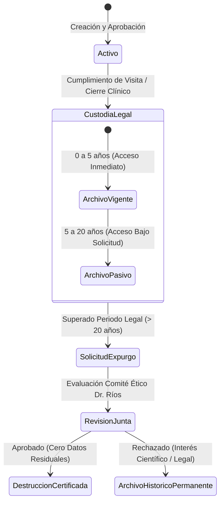

# VET FREEDOM OS — DOCUMENT RETENTION POLICY
## Política de Custodia, Plazos Legales de Retención y Ciclo de Vida Documental en Colombia

**Proyecto:** VET FREEDOM OS  
**Módulo:** `VET-CORE-13`  
**Dirección Médica:** Dr. Luis Eduardo Ríos  
**Marco Legal Aplicable:**
- Ley 576 de 2000 (Código de Ética Médico Veterinaria de Colombia)
- Resolución 1995 de 1999 (Parámetros Generales de Custodia de Historias Clínicas en Colombia)
- Código de Comercio de Colombia (Art. 60)
- Estatuto Tributario de Colombia (Art. 632)
- Ley 1581 de 2012 (Régimen General de Protección de Datos Personales)

---

## 1. Obligación Legal de Custodia Documental

En Colombia, los documentos clínicos y administrativos veterinarios están sujetos a periodos mínimos obligatorios de archivo y conservación. La eliminación prematura de una historia clínica veterinaria constituye una falta ética gravísima sancionable por el Tribunal Nacional de Ética Profesional de COMVEZCOL.

---

## 2. Matriz de Retención por Categoría Documental

La tabla `document_retention_policies` en Supabase define y automatiza los siguientes periodos legales:

| Tipo de Documento | Periodo Mínimo de Retención | Base Legal | Acción al Vencimiento | Requiere Junta Médica |
| :--- | :---: | :--- | :--- | :---: |
| **Historia Clínica y Reportes Médicos** (`CLINICAL_REPORT`) | **20 años** | Ley 576/00 Art. 35, Res. 1995/99 | Transferencia a Archivo Histórico Cifrado | **SÍ** |
| **Certificados de Vacunación y Desparasitación** | **5 años** | Control Sanitario ICA / Zoonosis | Archivo Pasivo / Expurgo Autorizado | SÍ |
| **Cartas e Informes de Remisión** (`REFERRAL_LETTER`) | **10 años** | Código de Comercio y Responsabilidad Civil | Archivo Pasivo | SÍ |
| **Facturas y Recibos de Caja** (`INVOICE`) | **5 años** | Estatuto Tributario Art. 632 / DIAN | Expurgo Contable o Custodia DIAN | NO |
| **Tokens Efímeros de Acceso** (`ACCESS_GRANTS`) | **1 año** | Ley 1581 de 2012 (Auditoría Forense) | Purgado Automático de Tokens Expirados | NO |
| **Archivos Temporales / Borradores Rechazados** | **90 días** | Higiene Operativa de Almacenamiento | Purga Automática tras Notificación | NO |

---

## 3. Estados del Ciclo de Vida de Retención

---

## 4. Auditoría Periódica y Reportes de Custodia

El sistema ejecuta una tarea mensual programada en `VET-CORE-13` para:
1. Identificar documentos que han alcanzado su tiempo límite de retención.
2. Generar un informe consolidado en `document_deletion_requests` para la revisión personal del Dr. Luis Eduardo Ríos.
3. Prevenir cualquier borrado accidental mediante bloqueos en nivel de base de datos (`FOREIGN KEY RESTRICT` en tablas históricas).
