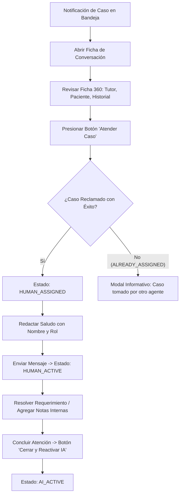

# HUMAN RESPONSE RUNBOOK & OPERATIONAL PLAYBOOK
## VET FREEDOM OS — Manual de Operación para Personal Humano
**Dirección Médica:** Dr. Luis Eduardo Ríos  
**Empresa:** Vet Life — Veterinaria a Domicilio  
**Fecha:** 2026-11-21  

---

## 1. Procedimiento de Atención en Lovable UI

---

## 2. Pautas Obligatorias de Comunicación

### Identificación y Saludo Inicial:
- Todo mensaje inicial humano **debe identificarse con nombre propio y cargo**:
  - *Ejemplo Coordinación:* "Buenas tardes, Carolina. Te habla Andrés Salcedo, Coordinador de Vet Life. Con gusto te confirmo la hora de visita para Toby."
  - *Ejemplo Médico:* "Hola Carolina, soy la Dra. Camila Torres de Vet Life. Estoy revisando la evolución de Toby..."

### Manejo de Notas Internas:
- Las notas internas son para uso exclusivo del personal de Vet Life (médicos, coordinadores, recepción).
- **Prohibido:** Colocar datos médicos o compromisos de agenda únicamente en notas internas sin confirmarle al tutor.
- **Uso Recomendado:** "Tutor prefiere pago en efectivo", "Paciente agresivo con desconocidos, requiere bozal en consulta domiciliaria", "Confirmada llegada a las 3:30 PM".

### Cierre de Atención:
- Antes de presionar "Cerrar y Reactivar IA", verificar que:
  1. No queden preguntas clínicas sin responder.
  2. La cita haya sido confirmada o reagendada en el sistema.
  3. El tutor haya recibido el mensaje de despedida cordial.
