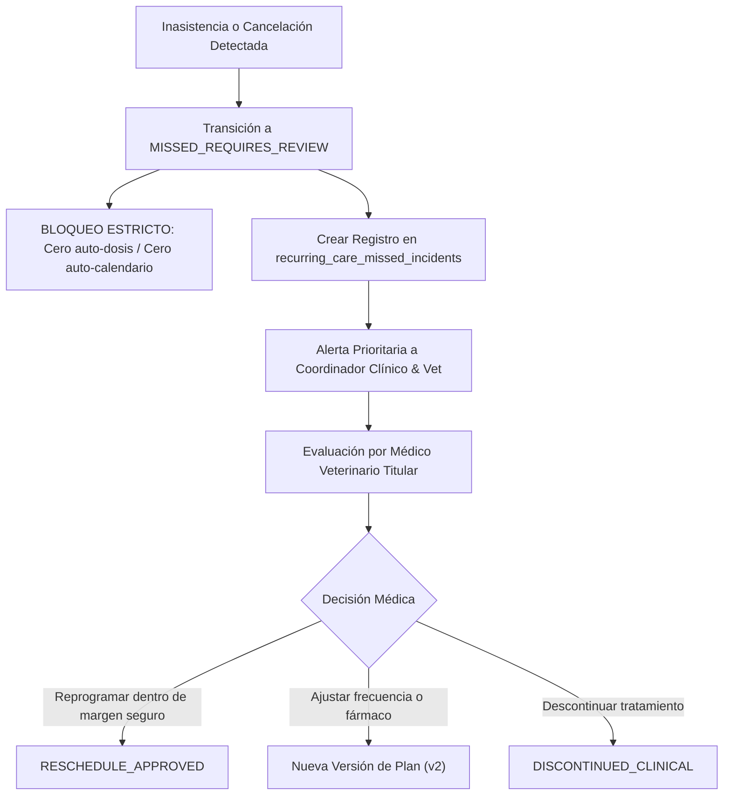

# VET FREEDOM OS — MISSED TREATMENT VISIT PROTOCOL
## Protocolo Ante Visitas Fallidas, Inasistencias y Abandono Terapéutico
**Módulo:** VET-CORE-09  
**Axioma Operativo:** CERO Compensación Automática, CERO Ajuste de Dosis por IA  

---

## 1. Clasificación del Incidente de Inasistencia

| Tipo de Fallo | Causa Raíz | Severidad Clínica | Acción Inmediata |
| :--- | :--- | :--- | :--- |
| `CLIENT_NO_SHOW` | Tutor ausente en domicilio | `CRITICAL_THERAPY_INTERRUPTION` | Marcar `MISSED_REQUIRES_REVIEW` + Alerta Coordinación |
| `CLIENT_CANCELLATION_LATE` | Tutor cancela < 2h antes | `MODERATE_DELAY` | Registro de motivo + Notificar Veterinario Titular |
| `VET_EMERGENCY_OVERRUN` | Cirugía/urgencia previa retrasada | `MODERATE_DELAY` | Contactar al tutor para reprogramar en franja de tolerancia |
| `LOGISTIC_UNREACHABLE` | Bloqueo vial / fuerza mayor | `LOW_IMPACT` | Reprogramar dentro de la ventana de tolerancia |
| `PATIENT_UNSTABLE` | Paciente descompensado en casa | `CRITICAL_THERAPY_INTERRUPTION` | Escalamiento inmediato a Urgencia Médica Domiciliaria |

---

## 2. Diagrama de Flujo y Resguardo de Seguridad

