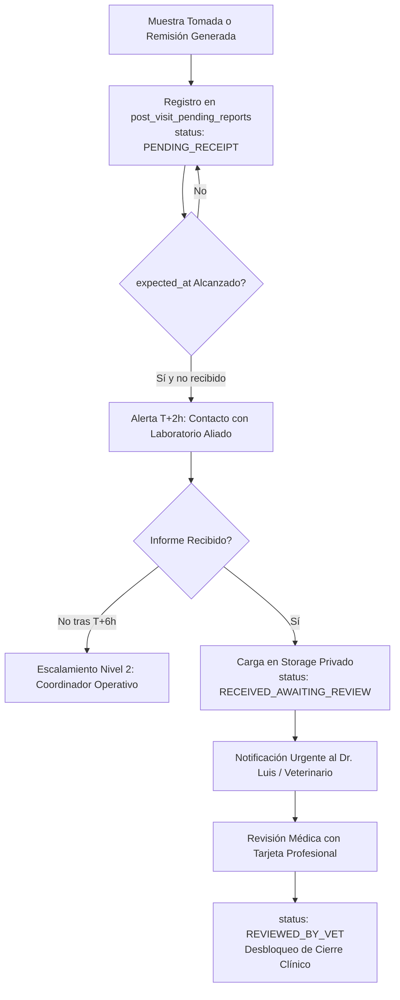

# VET FREEDOM OS — PENDING REPORT FOLLOW-UP RUNBOOK
## Seguimiento, Recepción y Verificación Médica de Resultados e Informes Externos
**Módulo:** VET-CORE-12 | POST-VISIT COMMITMENTS & CONTINUITY HUB  
**Dirección Médica:** Dr. Luis Eduardo Ríos  
**Integración:** CORE-11 (Specialist Hub) + Supabase Storage (`medical-records/reports/`)  
**Tabla de Seguimiento:** `public.post_visit_pending_reports`  

---

## 1. El Riesgo Clínico del Informe Desatendido

En medicina veterinaria a domicilio, uno de los puntos críticos de falla es la pérdida de seguimiento de muestras enviadas a laboratorios externos o estudios especializados remitidos (ej. biopsias, perfiles bioquímicos, ecocardiogramas). Si el resultado llega y nadie lo revisa, o si el laboratorio se retrasa y nadie lo reclama, el paciente sufre retrasos terapéuticos graves.

El subsistema de seguimiento de informes pendientes audita activamente cada resultado esperado hasta su revisión médica definitiva.

---

## 2. Tipología de Informes Auditados

| Tipo de Informe | Proveedor Típico | Plazo Promedio | Criticidad |
|---|---|---|---|
| `LABORATORY` (Hemograma / Química) | Laboratorio Clínico Veterinario Aliado | 6 – 12 horas | Alta |
| `IMAGING` (Ecografía / Rayos X) | Centro de Imagenología / Especialista Móvil | 12 – 24 horas | Alta |
| `PATHOLOGY` (Citología / Biopsia) | Patólogo Veterinario de Referencia | 3 – 5 días hábiles | Muy Alta |
| `SPECIALIST_CONSULT` (Informe Interconsulta) | Médico Especialista Externo (CORE-11) | 24 – 48 horas | Media-Alta |

---

## 3. Cronograma de Seguimiento Proactivo

El motor de n8n evalúa periódicamente las fechas esperadas de entrega (`expected_at`):

---

## 4. Almacenamiento Seguro y Control de Acceso

1. **Bucket Privado:** Los documentos en PDF, imágenes o reportes DICOM se almacenan en el bucket privado `medical-records/reports/{case_id}/{report_id}.pdf`.
2. **URLs Firmadas Efímeras:** Queda prohibido el uso de enlaces públicos permanentes. Se generan URLs firmadas con validez máxima de 15 minutos exclusivamente para la visualización del médico tratante en Lovable.
3. **Firma Obligatoria de Revisión:** La transición a `REVIEWED_BY_VET` requiere que el veterinario registre sus notas de interpretación clínica, diagnóstico definitivo y actualización del plan terapéutico.
