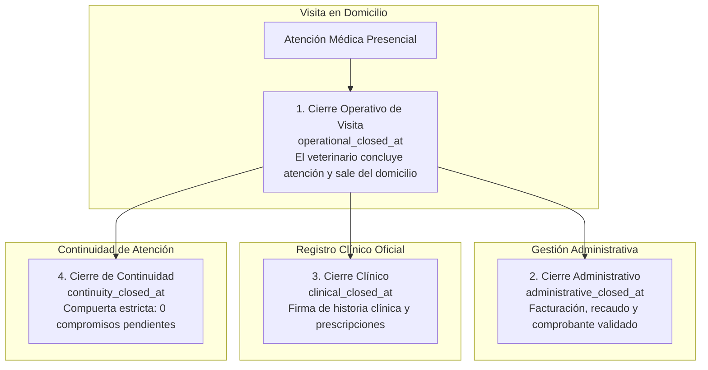

# VET FREEDOM OS — POST-VISIT CLOSURE GATE RUNBOOK
## Protocolo y Condiciones Inquebrantables de Cierre de Continuidad Post-Atención
**Módulo:** VET-CORE-12 | POST-VISIT COMMITMENTS & CONTINUITY HUB  
**Dirección Médica:** Dr. Luis Eduardo Ríos  
**RPC de Validación:** `public.close_post_visit_continuity_verified`  
**Tabla de Auditoría:** `public.post_visit_closure_checks`  

---

## 1. La Separación Fundamental de los Cuatro Cierres

Uno de los pilares de diseño de Vet Freedom OS es la separación arquitectónica y operativa de los 4 tipos de cierre de una visita domiciliaria:



---

## 2. Reglas Estrictas de la Compuerta de Continuidad (Closure Gate)

La función almacenada `close_post_visit_continuity_verified` evalúa de forma atómica y transaccional los siguientes requisitos antes de permitir el cierre definitivo del caso de post-visita (`status = 'COMPLETED_VERIFIED'`):

1. **Cero Compromisos Obligatorios Pendientes:**
   - No puede existir ningún registro en `public.post_visit_commitments` asociado al caso cuyo estado sea `PENDING`, `IN_PROGRESS`, `BLOCKED`, `SNOOZED`, o `ESCALATED`, a menos que haya sido formalmente exonerado por el veterinario (`EXONERATED_BY_VET`).
2. **Cero Informes de Laboratorio o Especialistas sin Revisar:**
   - Todos los registros en `public.post_visit_pending_reports` deben estar en estado `REVIEWED_BY_VET` o `EXONERATED_BY_VET`. La existencia de un informe en `PENDING_RECEIPT` o `RECEIVED_AWAITING_REVIEW` aborta el cierre de inmediato.
3. **Cero Documentos Pendientes de Entrega:**
   - Todos los documentos obligatorios en `public.post_visit_pending_documents` deben estar en `DELIVERED_CONFIRMED` o `WAIVED`.
4. **Firma Obligatoria por Médico Veterinario Colegiado:**
   - La persona que solicita el cierre debe existir en `public.staff_profiles`, estar activa y tener número de tarjeta profesional COMVEZCOL vigente. Si un auxiliar, recepcionista o proceso desatendido intenta cerrar el caso, la base de datos lanza excepción `P0001: Unauthorized veterinary role`.

---

## 3. Registro y Trazabilidad Inmutable

Cada intento de cierre (sea aprobado o rechazado) se audita en `public.post_visit_closure_checks`:

```json
{
  "closure_check_id": "c0a80140-0000-0000-0000-000000000001",
  "case_id": "c0a80120-0000-0000-0000-000000000001",
  "veterinarian_id": "c0a80101-0000-0000-0000-000000000001",
  "professional_card": "COMVEZCOL-001",
  "checks_passed": true,
  "pending_commitments_count": 0,
  "pending_reports_count": 0,
  "pending_documents_count": 0,
  "decision": "APPROVED",
  "evaluated_at": "2026-11-21T15:30:00Z"
}
```

Si la compuerta rechaza el cierre, devuelve detalladamente la lista de compromisos o informes pendientes que bloquean la finalización, impidiendo que los casos caigan en el olvido.
