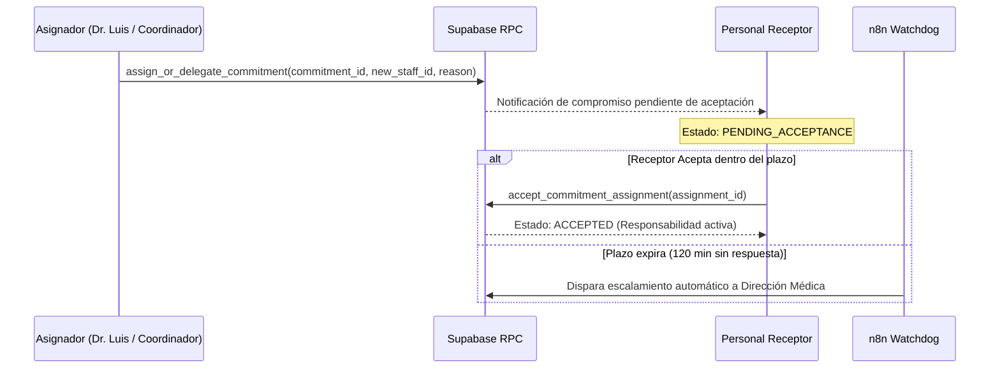

# VET FREEDOM OS — POST-VISIT COMMITMENT DELEGATION RUNBOOK
## Asignación, Reasignación, Delegación y Aceptación de Compromisos Operativos
**Módulo:** VET-CORE-12 | POST-VISIT COMMITMENTS & CONTINUITY HUB  
**Dirección Médica:** Dr. Luis Eduardo Ríos  
**Tabla de Asignaciones:** `public.post_visit_commitment_assignments`  
**RPCs:** `assign_or_delegate_commitment`, `accept_commitment_assignment`  

---

## 1. Principio de Responsabilidad Unívoca

Cada compromiso post-visita debe tener en todo momento exactamente un responsable principal activo (`responsible_staff_id`). Las tareas sin dueño o compartidas sin titular están prohibidas por diseño en Vet Freedom OS para evitar dilución de responsabilidades.

---

## 2. Tipos de Delegación según Naturaleza del Compromiso

1. **Compromisos Clínicos (Categoría `CLINICAL`):**
   - Interpretación de exámenes de laboratorio.
   - Ajustes terapéuticos y emisión de fórmulas médicas.
   - Notificación de resultados diagnósticos al tutor.
   - **Regla Inquebrantable:** Solo pueden ser delegados a profesionales registrados en `public.staff_profiles` con tarjeta profesional COMVEZCOL vigente. Queda prohibida la delegación a personal administrativo o auxiliar.
2. **Compromisos Administrativos y Logísticos (Categorías `ADMINISTRATIVE`, `LOGISTICAL`):**
   - Envío de comprobantes de pago o facturación electrónica.
   - Coordinación de rutas de entrega de medicamentos en stock.
   - Gestión de presupuestos con centros de referencia.
   - Pueden ser asignados y delegados a coordinadores de operaciones y asistentes veterinarios.

---

## 3. Protocolo de Delegación en Dos Fases (Handshake)

Para evitar que una tarea delegada quede desatendida porque el destinatario no se percató:

---

## 4. Auditoría y Trazabilidad

Cada traspaso de responsabilidad genera:
- Un registro inmutable en `post_visit_commitment_assignments`.
- Una nueva versión en `post_visit_commitment_versions`.
- Una entrada en `post_visit_audit` con el motivo explícito de la delegación (ej. "Reasignación por atención de urgencia domiciliaria simultánea").
