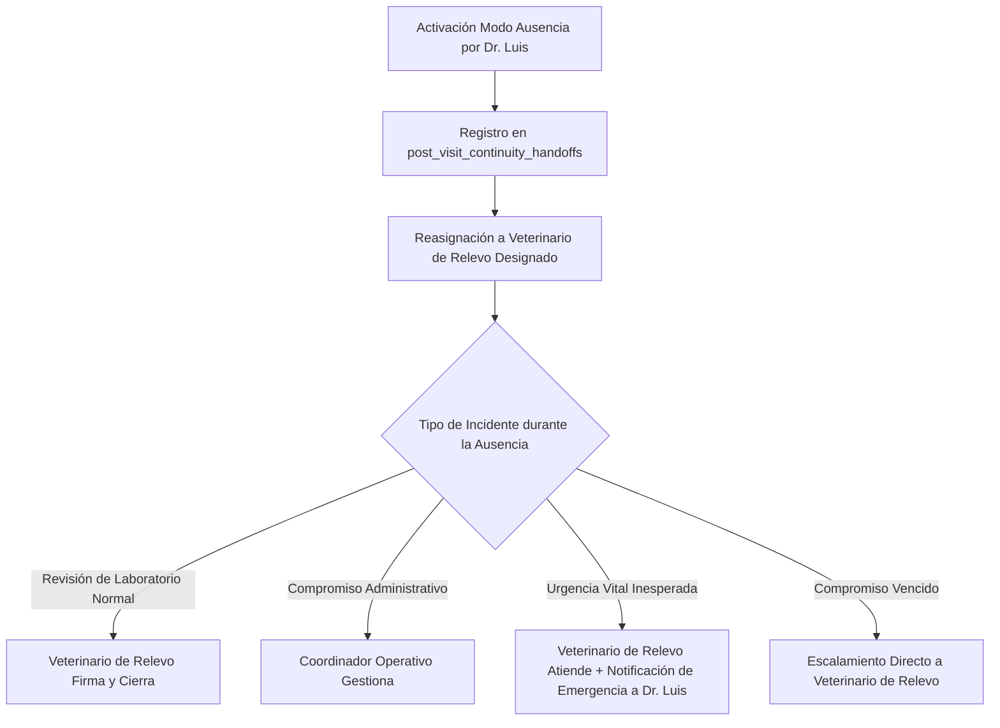

# VET FREEDOM OS — FOUNDER ABSENCE MODE RUNBOOK
## Protocolo de Continuidad Operativa y Clínica ante Ausencia del Dr. Luis Eduardo Ríos
**Módulo:** VET-CORE-12 | POST-VISIT COMMITMENTS & CONTINUITY HUB  
**Dirección Médica:** Dr. Luis Eduardo Ríos  
**Tabla de Traspasos:** `public.post_visit_continuity_handoffs`  

---

## 1. Justificación y Alcance

Vet Life opera bajo la dirección técnica del Dr. Luis Eduardo Ríos. Sin embargo, para garantizar una operación verdaderamente resiliente, escalable y libre de cuellos de botella ("Founder Freedom"), el sistema dispone de un modo estructurado de ausencia temporal del fundador (congresos, cirugías complejas, emergencias familiares o descanso programado).

El modo de ausencia garantiza que la continuidad de los pacientes no se detenga ni un solo minuto y que los compromisos clínicos se gestionen con la misma rigurosidad por profesionales de relevo debidamente habilitados.

---

## 2. Activación del Modo Ausencia

1. **Configuración Previa:** En la interfaz de Lovable, el Dr. Luis define:
   - Ventana de ausencia: `start_time` y `end_time`.
   - Veterinario(a) de relevo designado(a): Registro verificado en `public.staff_profiles` con tarjeta COMVEZCOL activa.
   - Nivel de interrupción admitido: Solo Urgencias Vitales vs Cero Interrupciones.
2. **Reasignación Automática de Compromisos Activos:**
   - Todo nuevo compromiso clínico post-visita se asigna de forma directa al veterinario de relevo.
   - Las tareas en curso con vencimiento dentro de la ventana de ausencia son transferidas con motivo `FOUNDER_ABSENCE_HANDOFF`.
3. **Generación del Briefing de Continuidad (WFX-008):**
   - El sistema genera un resumen estructurado en `post_visit_continuity_handoffs` con la lista de pacientes críticos, informes de laboratorio pendientes y tratamientos en curso.

---

## 3. Matriz de Relevo y Escalabilidad

---

## 4. Retorno del Fundador y Conciliación

Al finalizar la ventana de ausencia (`end_time` alcanzado):
1. El sistema desactiva el enrutamiento automático de relevo.
2. Se compila y entrega al Dr. Luis un **Informe Ejecutivo de Continuidad**:
   - Total de compromisos completados durante la ausencia.
   - Informes de laboratorio revisados y firmados por el relevo.
   - Casos post-visita que continúan abiertos y requieren seguimiento del fundador.
   - Auditoría completa de todas las acciones ejecutadas.
