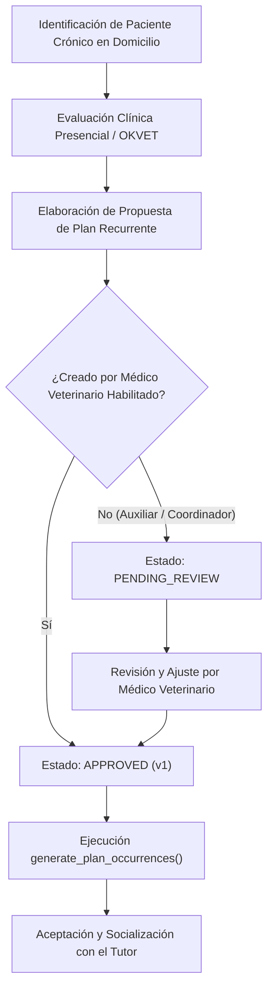

# VET FREEDOM OS — RECURRING CARE APPROVAL
## Procedimiento Operativo de Aprobación de Planes Clínicos
**Módulo:** VET-CORE-09  
**Responsable:** Dr. Luis Eduardo Ríos (Dirección Médica)  

---

## 1. Flujo de Trabajo para la Creación y Aprobación

---

## 2. Parámetros Mínimos Obligatorios para la Aprobación

1. **Diagnóstico Concluyente:** Título nosológico formal (ej. Insuficiencia Renal Crónica IRIS 2).
2. **Objetivo Terapéutico:** Meta medible (ej. Control de uremia y mantenimiento de hidratación subcutánea).
3. **Número de Sesiones Prescritas:** Conteo cerrado o franja con hito de revisión intermedia.
4. **Cadencia y Frecuencia:** Intervalo en días e identificación de criticidad de ventana (`is_window_strict`).
5. **Insumos y Fármacos:** Relación de requerimientos especiales (cadena de frío, antibióticos, agujas especiales).
