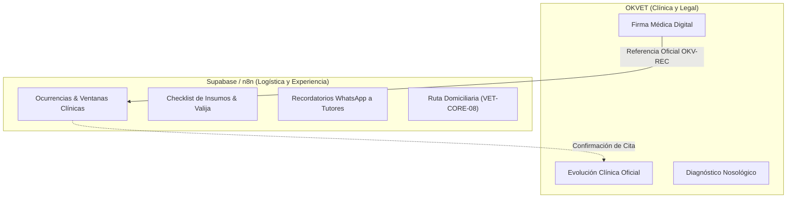

# VET FREEDOM OS — RECURRING CARE OKVET RECONCILIATION
## Protocolo de Sincronización y Reconciliación con OKVET
**Módulo:** VET-CORE-09  
**Fuente de Verdad Clínica:** OKVET (Sistema Oficial de Historia Clínica)  
**Fuente de Verdad Operativa:** Supabase PostgreSQL 17  

---

## 1. Separación de Responsabilidades Arquitectónicas

---

## 2. Reglas de Conciliación Operativa

1. **Procedimiento Autorizado Exclusivo:** La vinculación con OKVET se realiza únicamente mediante procedimientos y referencias oficiales (`okvet_reference`). Queda prohibida cualquier manipulación directa no autorizada de la base de datos de OKVET.
2. **Confirmación en OKVET Previa a la Ejecución:** Una ocurrencia no se incorpora a la ruta domiciliaria definitiva de VET-CORE-08 si no cuenta con confirmación en el agendamiento formal.
3. **Cierre Clínico vs Cierre Logístico:** El estado `COMPLETED` en `recurring_visit_occurrences` certifica la realización física de la visita domiciliaria; el médico debe diligenciar y firmar la evolución correspondiente en OKVET al término de su jornada.
