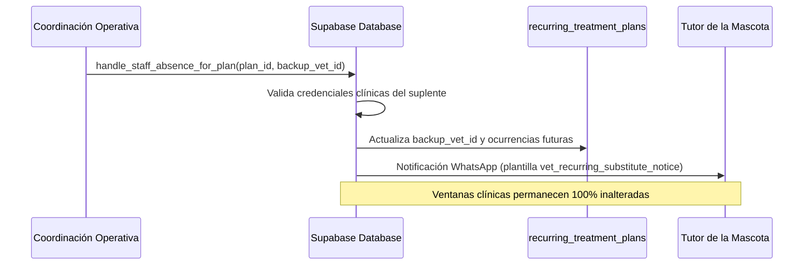

# VET FREEDOM OS — RECURRING CARE STAFF ABSENCE
## Protocolo de Traspaso Seguro (Handover) y Suplencia Médica
**Módulo:** VET-CORE-09  
**Procedimiento Almacenado:** `handle_staff_absence_for_plan()`  

---

## 1. Principios de la Suplencia Médica Domiciliaria

La relación médico-paciente es el eje de la confianza en Vet Life. Sin embargo, ante vacaciones, licencias o incapacidad médica del veterinario titular:
1. **Verificación de Idoneidad Profesional:** El suplente debe ser un veterinario graduado, matriculado (`is_clinical = true`) y activo en el sistema (`is_active = true`).
2. **Preservación Inviolable de Ventanas:** La ausencia del veterinario titular no autoriza a correr o suspender arbitrariamente las fechas de las sesiones de los pacientes críticos.
3. **Comunicación Transparente al Tutor:** El tutor recibe una notificación oportuna informando la asignación del médico suplente con su nombre y credenciales.
4. **Inmutabilidad del Historial:** Las sesiones ya completadas por el titular conservan intacta la autoría original (`assigned_veterinarian_id`). Las sesiones futuras pendientes se reasignan con `backup_veterinarian_id`.

