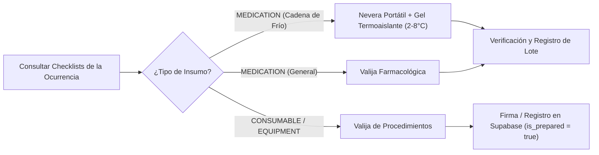

# VET FREEDOM OS — RECURRING VISIT PREPARATION
## Procedimiento de Preparación de Insumos, Cadena de Frío y Valija
**Módulo:** VET-CORE-09  
**Interacción:** `recurring_care_supply_checklists` $\rightarrow$ Valija Domiciliaria  

---

## 1. Protocolo de Preparación de Valija Médica

Antes de cada salida a ruta (VET-CORE-08), el personal auxiliar o de farmacia debe preparar los insumos asociados a cada ocurrencia programada:

---

## 2. Puntos de Control Obligatorios

- **Verificación de Lote y Vencimiento:** Medicamentos como eritropoyetina, fluidos parenterales o antibióticos no pueden cargarse a la valija sin registrar el número de lote y fecha de expiración.
- **Chequeo de Cadena de Frío:** Registro de temperatura previa al embalaje en nevera térmica domiciliaria.
- **Insumos de Paciente Cardiópata / Crítico:** Disponer de oxígeno portátil de emergencia y fonendoscopio calibrado.
