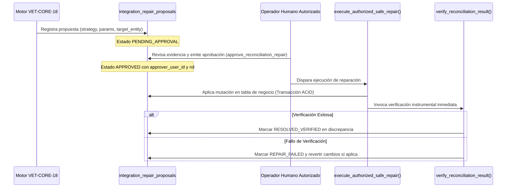

# VET FREEDOM OS — RUNBOOK: APROBACIÓN DE REPARACIONES SEGURAS
## Flujo de Autorización, Ejecución Atómica y Reversión de Cambios

---

### 1. Flujo de Trabajo para Propuestas que Exigen Aprobación

---

### 2. Parámetros de Seguridad de la Función `execute_authorized_safe_repair`

1. **Verificación de Aprobación Previa**:
   La función aborta con excepción si la propuesta no tiene una fila coincidente en `integration_repair_approvals` o si el estado no es `APPROVED`.
2. **Chequeo de Vigencia Temporal**:
   Si la aprobación tiene más de 24 horas de antigüedad, se rechaza por obsolescencia de contexto (`STALE_APPROVAL`). El operador debe reconfirmar que las condiciones del negocio no han cambiado.
3. **Ejecución Idempotente**:
   Cada comando de reparación evalúa precondiciones atómicas (`WHERE status = 'old_status'`) para impedir que una doble ejecución corrompa datos si la red experimenta lentitud.

---

### 3. Procedimiento de Rollback (Reversión de Reparaciones)

En el improbable caso de que una reparación aprobada genere un resultado no deseado:
1. Localizar el registro en `integration_repair_executions` mediante su UUID.
2. Extraer el campo `rollback_payload` (que contiene el snapshot exacto previo a la mutación).
3. Invocar el script de reversión supervisado por el Administrador de Sistemas en Supabase SQL Editor.
4. Documentar el incidente en `integration_reconciliation_audit` con categoría `MANUAL_ROLLBACK`.
