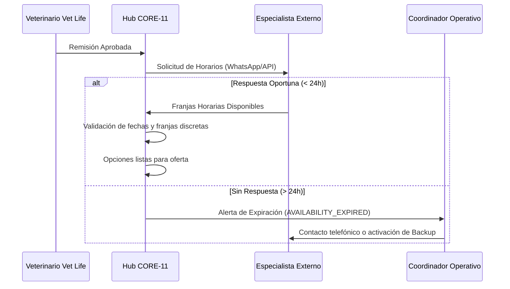

# VET FREEDOM OS — SPECIALIST AVAILABILITY OPERATIONS SOP
## Procedimiento Operativo: Solicitud, Registro y Gestión de Horarios de Especialistas
**Módulo:** VET-CORE-11 | SPECIALIST COORDINATION  
**Dirección Médica:** Dr. Luis Eduardo Ríos  
**Tablas Operativas:** `specialist_availability_requests`, `specialist_availability_responses`, `specialist_availability_options`  

---

## 1. Ciclo Operativo de Gestión de Disponibilidad

---

## 2. Reglas de Validación de Franjas Horarias

1. **Anticipación Mínima:** Las franjas deben ofrecerse con un mínimo de 12 horas hábiles de anticipación para permitir la confirmación del tutor y la preparación logística.
2. **Fecha Futura Estricta:** El sistema descarta y marca como `EXPIRED` cualquier franja horaria cuya fecha/hora sea anterior al momento del registro.
3. **Manejo de Ambigüedad:** Si la respuesta recibida carece de hora exacta (ej. *"el jueves en la tarde"*), el operador debe marcar `is_ambiguous = true` y contactar a la clínica antes de presentar opciones al tutor.
4. **Vigencia de Opciones:** Las franjas registradas tienen una vigencia por defecto de 24 horas (`valid_until`), tras las cuales se asume que el cupo puede haber sido ocupado por la clínica receptora.
