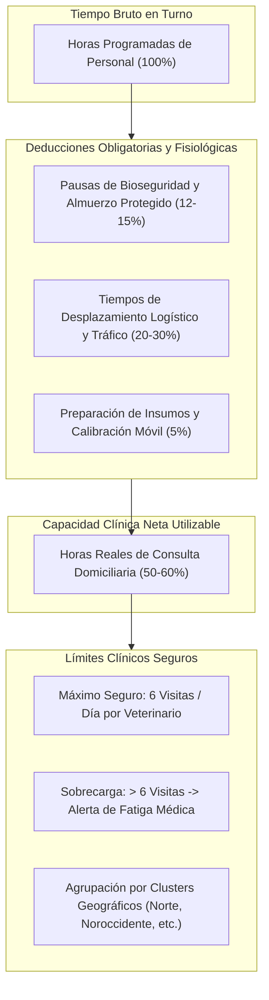

# Planificación de Capacidad Médica y Logística Semanal (VET-CORE-17)

**Módulo:** `VET-CORE-17 | WEEKLY REPORTING`  
**Proyecto:** VET FREEDOM OS — Vet Life: Veterinaria a Domicilio  
**Dirección Médica:** Dr. Luis Eduardo Ríos  
**Dirección Estratégica:** Alpha Vision Method  
**Entorno:** DEVELOPMENT / QA  
**Fecha:** 2026-11-21  

---

## 1. El Modelo de Capacidad en Veterinaria Domiciliaria

A diferencia de una clínica fija donde los pacientes se desplazan hacia el consultorio, en Vet Life los recursos médicos (veterinarios y móviles equipados) deben desplazarse por la geografía urbana de Bogotá.

---

## 2. Métricas y Reglas de Salud del Equipo Médico

1. **Protección de Descansos (T43, T50):** Las pausas de descanso y bioseguridad jamás se consideran horas disponibles para citas adicionales. Queda terminantemente prohibido sugerir recortar descansos para inflar la capacidad aparente.
2. **Índice de Sobrecarga (T46):** Realizar más de 6 consultas domiciliarias al día incrementa exponencialmente el riesgo de error médico en dosificación de fármacos y fatiga al volante. El sistema marca con bandera roja a cualquier profesional que supere este límite.
3. **Optimización de Rutas por Densidad Geográfica:** Si la relación `(Tiempo en Traslado / Horas de Consulta)` supera el **35%**, se dispara una sugerencia de rezonificación hacia CORE-08 (Rutas) para evitar cruces innecesarios de la ciudad.
