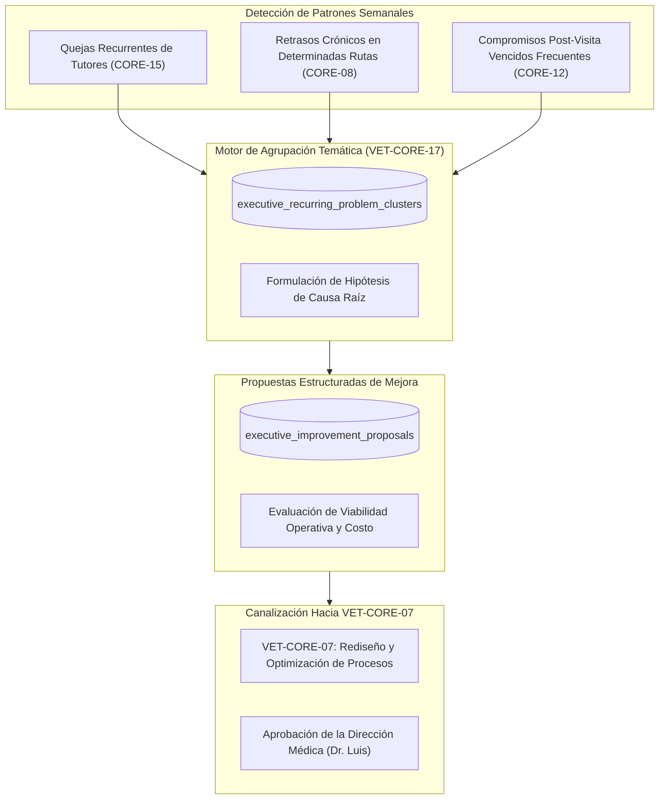

# Mejora Continua y Canalización Hacia CORE-07 (VET-CORE-17)

**Módulo:** `VET-CORE-17 | WEEKLY REPORTING`  
**Proyecto:** VET FREEDOM OS — Vet Life: Veterinaria a Domicilio  
**Dirección Médica:** Dr. Luis Eduardo Ríos  
**Dirección Estratégica:** Alpha Vision Method  
**Entorno:** DEVELOPMENT / QA  
**Fecha:** 2026-11-21  

---

## 1. De la Detección de Fallas a la Solución Estructural

El reporte semanal no se limita a constatar errores del pasado; su función superior es **aprender de las desviaciones operativas y alimentar la evolución continua del sistema**.

---

## 2. Reglas de Validación de Hipótesis y Mejoras

1. **Distinción entre Hipótesis y Hecho Demostrado (T98):** El informe ejecutivo debe indicar con absoluta claridad si una conclusión es un hecho verificado con datos de sensores/bitácoras o una conjetura teórica sujeta a validación en campo.
2. **No Ejecución Automática Sin Aprobación (T99):** Ninguna propuesta de mejora estructural (cambio de horarios de inicio de turnos, alteración de tiempos de consulta, reasignación de zonas) puede aplicarse de manera autónoma sin la venia explícita del Dr. Luis Eduardo Ríos.
3. **Invariabilidad Clínica (T100):** Las sugerencias de optimización logística o eficiencia de costos jamás pueden reducir los tiempos mínimos de examen clínico ni comprometer la bioseguridad del paciente y del equipo veterinario.
