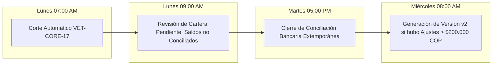

# Procedimiento de Revisión Financiera y Conciliación Semanal (VET-CORE-17)

**Módulo:** `VET-CORE-17 | WEEKLY REPORTING`  
**Proyecto:** VET FREEDOM OS — Vet Life: Veterinaria a Domicilio  
**Dirección Médica:** Dr. Luis Eduardo Ríos  
**Dirección Estratégica:** Alpha Vision Method  
**Entorno:** DEVELOPMENT / QA  
**Fecha:** 2026-11-21  

---

## 1. El Ciclo Semanal de Conciliación Financiera

La revisión financiera de Vet Life se fundamenta en la estricta conciliación entre lo emitido contablemente y los fondos reales acreditados en cuentas bancarias o pasarelas:

---

## 2. Puntos de Control y Auditoría Financiera

1. **Brecha Facturado vs Cobrado:** Si la efectividad de recaudo es inferior al **90%**, el sistema lista individualmente las cuentas con más de 48 horas sin comprobante para gestión de cartera.
2. **Costos Directos Variables:**
   - Comparación de consumo de medicamentos contra el inventario teórico de visitas.
   - Rendimiento de combustible por kilómetro recorrido registrado por los vehículos.
   - Pagos pendientes a especialistas por interconsultas ya facturadas a tutores.
3. **Margen de Contribución por Servicio:** Evaluación del margen porcentual entre medicina preventiva, consultas generales, urgencias y paquetes de tratamiento crónico.
