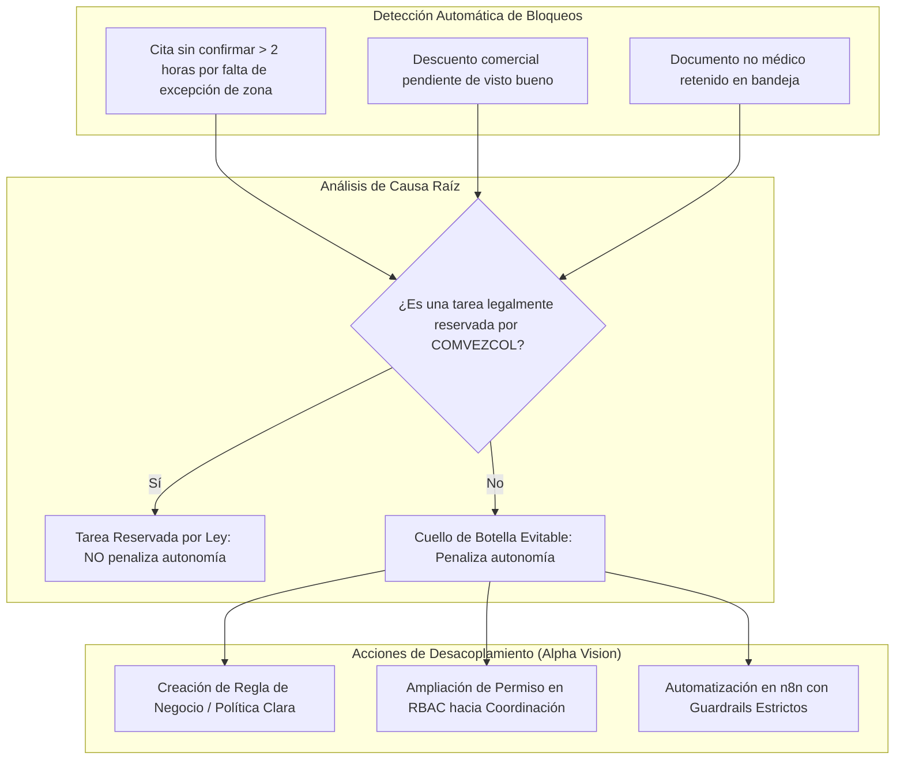

# Protocolo de Gestión de la Dependencia del Fundador (WF-075)

**Módulo:** `VET-CORE-17 | WEEKLY REPORTING`  
**Proyecto:** VET FREEDOM OS — Vet Life: Veterinaria a Domicilio  
**Dirección Médica:** Dr. Luis Eduardo Ríos  
**Dirección Estratégica:** Alpha Vision Method  
**Entorno:** DEVELOPMENT / QA  
**Fecha:** 2026-11-21  

---

## 1. Detección y Medición de Cuellos de Botella de Luis

Para que Vet Life opere con autonomía y libertad, el sistema audita semanalmente los puntos de contacto donde los procesos se detuvieron a la espera de la intervención del Dr. Luis.

---

## 2. Plan de Acción Ante Dependencia Elevada

Si en una semana la Tasa de Autonomía cae por debajo del umbral mínimo del **80%**:
1. **Alerta Ejecutiva:** El WBR incluye un recuadro de advertencia rojo: `FOUNDER_BOTTLENECK_ALERT`.
2. **Desglose de Tareas Bloqueadas:** Se genera un listado en `executive_weekly_action_plans` detallando:
   - Tipo de decisión requerida.
   - Tiempo promedio que estuvo detenida la operación.
   - Impacto económico o en satisfacción del tutor.
3. **Propuesta de Delegación Estructurada:** El sistema sugiere una delegación formal hacia el Coordinador Operativo o la activación de una regla automática en Supabase (ej. *"Permitir reagendamientos sin costo si la cancelación se hizo con más de 4 horas de antelación sin consultar al Dr. Luis"*).
