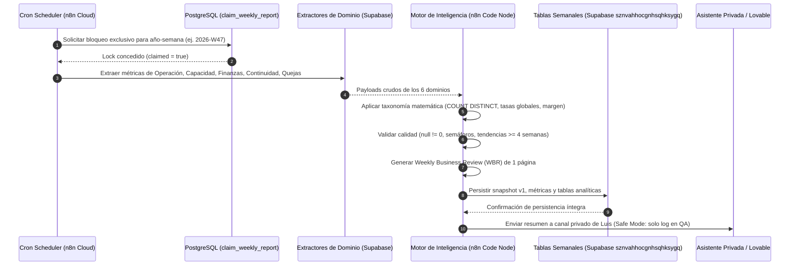

# Procedimiento Operativo Estándar: Generación del Reporte Semanal (VET-CORE-17)

**Módulo:** `VET-CORE-17 | WEEKLY REPORTING`  
**Proyecto:** VET FREEDOM OS — Vet Life: Veterinaria a Domicilio  
**Dirección Médica:** Dr. Luis Eduardo Ríos  
**Dirección Estratégica:** Alpha Vision Method  
**Entorno:** DEVELOPMENT / QA  
**Fecha:** 2026-11-21  

---

## 1. Disparadores y Cronograma Oficial

El proceso de generación automática del reporte semanal se ejecuta todos los **lunes a las 07:00 AM America/Bogota**, cubriendo el período exacto de la semana calendario previa (Lunes 00:00:00.000 a Lunes siguiente 00:00:00.000 límite exclusivo).

---

## 2. Parámetros de Configuración del Workflow

- **Workflow ID en n8n Cloud:** `CM86KKfUxrbllCzz`
- **Nombre:** `VET-CORE-17 | Weekly Reporting`
- **Timezone:** `America/Bogota` (estrictamente forzada).
- **Invariante Safe Mode:** `send_enabled: false`, `active: false`.
- **Cron Expression:** `0 7 * * 1` (Lunes 07:00 AM hora local).
- **Webhook Endpoint:** `/webhook/reports/weekly` (con autenticación por token en header `x-vet-token`).

---

## 3. Verificación Post-Ejecución

Tras la ejecución matutina, el sistema valida automáticamente:
1. Fila creada en `executive_weekly_reports` con estado `COMPLETED`.
2. Fila creada en `executive_weekly_snapshots` con `version_number = 1`.
3. Registro de auditoría en `executive_weekly_audit` con evento `REPORT_GENERATED_V1`.
4. Ausencia de flags `FATAL_CALCULATION_ERROR`. En caso de fallo en alguna fuente externa, la métrica específica muestra `SOURCE_UNAVAILABLE` sin abortar el resto del informe.
