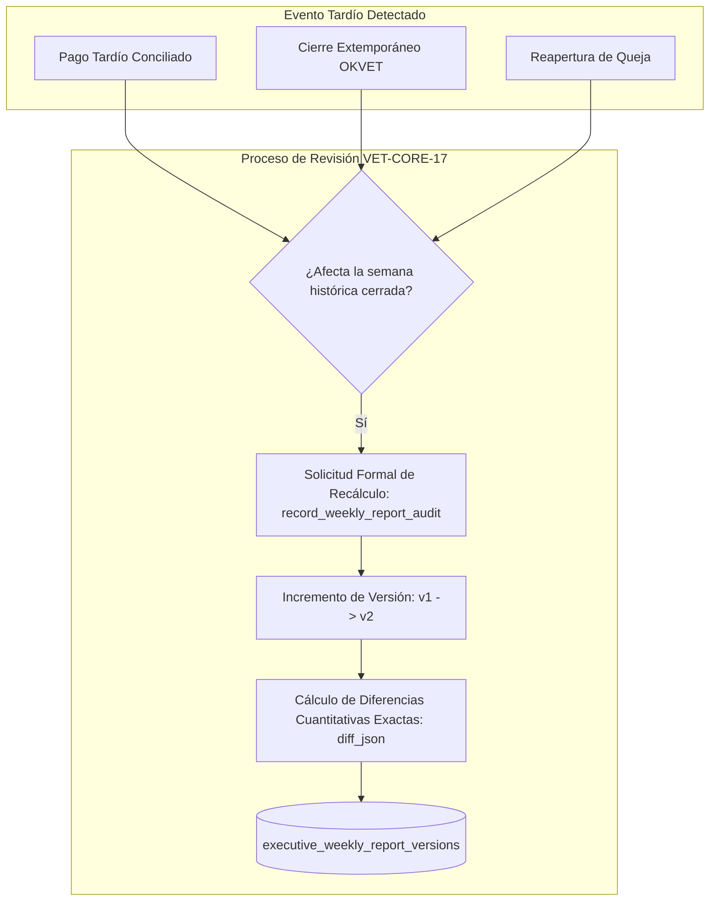

# Procedimiento Operativo: Revisiones y Recálculos Semanales (VET-CORE-17)

**Módulo:** `VET-CORE-17 | WEEKLY REPORTING`  
**Proyecto:** VET FREEDOM OS — Vet Life: Veterinaria a Domicilio  
**Dirección Médica:** Dr. Luis Eduardo Ríos  
**Dirección Estratégica:** Alpha Vision Method  
**Entorno:** DEVELOPMENT / QA  
**Fecha:** 2026-11-21  

---

## 1. Motivos Válidos para Generar una Revisión de Reporte

Un reporte semanal ya generado y cerrado en su versión inicial `v1` puede requerir una revisión si ocurren eventos tardíos del mundo real:
1. **Conciliación de Pagos Extemporáneos:** Un tutor transfirió el domingo por la tarde y el banco procesó y acreditó los fondos el martes siguiente.
2. **Cierre Tardío de Historia Clínica:** Un veterinario de ruta completó el informe de una cirugía o procedimiento especial el lunes tras recibir el reporte anatomopatológico.
3. **Corrección de Datos en OKVET:** Rectificación formal autorizada por la Dirección Médica de una ficha clínica o insumo registrado.
4. **Reapertura de Quejas:** Un tutor manifiesta disconformidad posterior sobre una queja que se había marcado inicialmente como resuelta.



---

## 2. Inmutabilidad y Regla de No Sobreescritura

- **Principio Fundamental:** La versión `v1` permanece **intacta e inmutable** en la tabla `executive_weekly_snapshots`.
- Cada nueva versión se almacena en `executive_weekly_report_versions` con:
  - `version_number`: `2`, `3`, etc.
  - `recalculation_reason`: Texto explicativo obligatorio (ej. *"Conciliación de 2 transferencias Bancolombia acreditadas el martes 2026-11-24"*).
  - `diff_json`: Objeto JSON con el antes y después de cada métrica alterada.
  - `triggered_by`: ID del usuario o sistema que solicitó el recálculo.

---

## 3. Disparo Manual de Recálculo Vía API

Para recalcular una semana histórica en QA o producción controlada:
```bash
curl -X POST https://n8n.vetlife.com/webhook/reports/weekly \
  -H "Content-Type: application/json" \
  -H "x-vet-token: $VET_REPORTING_KEY" \
  -d '{
    "event_type": "MANUAL_REVISION_REQUEST",
    "year_week": "2026-W46",
    "triggered_at": "2026-11-21T12:00:00-05:00",
    "requested_by": "dr_luis_rios",
    "recalculation_reason": "Auditoría de insumos médicos de anestesia",
    "qa_mode": true
  }'
```
