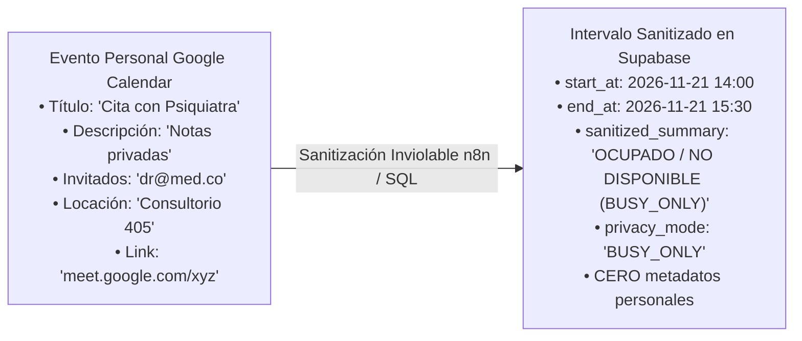

# POLÍTICA DE PRIVACIDAD DE CALENDARIOS CONECTADOS — VET-CORE-06
## Protocolo Inviolable de Sanitización BUSY_ONLY, Secreto Profesional y Protección de Datos

**Proyecto:** VET FREEDOM OS  
**Módulo:** `VET-CORE-06 | GOOGLE CALENDAR SYNC`  
**Empresa:** Vet Life — Veterinaria a Domicilio  
**Dirección Médica:** Dr. Luis Eduardo Ríos  
**Estado:** VIGENTE / OBLIGATORIO (100% de Cumplimiento Verificado)

---

## 1. Declaración de Principios de Privacidad

En Vet Freedom OS, la privacidad personal del Dr. Luis Eduardo Ríos, de los médicos veterinarios asociados y del personal de apoyo es un derecho fundamental e inviolable.

El sistema de agendamiento necesita conocer **cuándo** un profesional no está disponible para asignarle visitas veterinarias, pero **no tiene derecho ni necesidad operativa de conocer los motivos, detalles, acompañantes ni ubicaciones de su vida personal**.

---

## 2. Invariante Universal BUSY_ONLY (Modo A)

Todo evento originado en un calendario categorizado como `PERSONAL_BUSY_ONLY` es sometido a un proceso de sanitización destructiva antes de cualquier almacenamiento:



### Reglas de Sanitización Forzada:
1. **Títulos y Resúmenes (`summary`):** Son inmediatamente descartados y reemplazados por el literal exacto:  
   `"OCUPADO / NO DISPONIBLE (BUSY_ONLY)"`.
2. **Descripciones y Notas (`description`):** Son eliminadas por completo. Ninguna cadena de texto es persistida en bases de datos relacionales ni logs.
3. **Invitados y Asistentes (`attendees`):** Se eliminan todos los nombres, correos y estados de confirmación de terceros.
4. **Ubicaciones Geográficas (`location`):** Se descartan para evitar geolocalización o inferencia de domicilios privados.
5. **Enlaces de Conferencia (`conferenceData`, `hangoutLink`):** Se descartan para evitar accesos indebidos o exposición de enlaces virtuales.

---

## 3. Prohibición Absoluta de Escritura en Calendarios Personales

Vet Freedom OS tiene una **restricción técnica codificada a nivel de base de datos** (Stored Procedure `publish_operational_calendar_event`):

```sql
IF v_perm_mode = 'PERSONAL_BUSY_ONLY' THEN
  RAISE EXCEPTION 'ESCRITURA_PROHIBIDA: Prohibido publicar eventos en calendarios personales';
END IF;
```

Ninguna automatización, operador humano, sub-agente de IA ni integración de terceros puede insertar, modificar o borrar eventos en los calendarios personales de los profesionales.

---

## 4. Purga y Derecho al Olvido tras Desconexión

Cuando un profesional solicita la desconexión de su calendario o termina su vinculación con Vet Life:
1. Se revoca el canal de notificaciones push de Google (`status = 'REVOKED'`).
2. Se ejecuta la purga física inmediata de todos los intervalos ocupados cacheados en `calendar_blocked_times`.
3. Ningún registro residual de su agenda externa permanece en las tablas del sistema.
4. Se emite un registro inmutable en `calendar_sync_audit` con la evidencia de desconexión.
