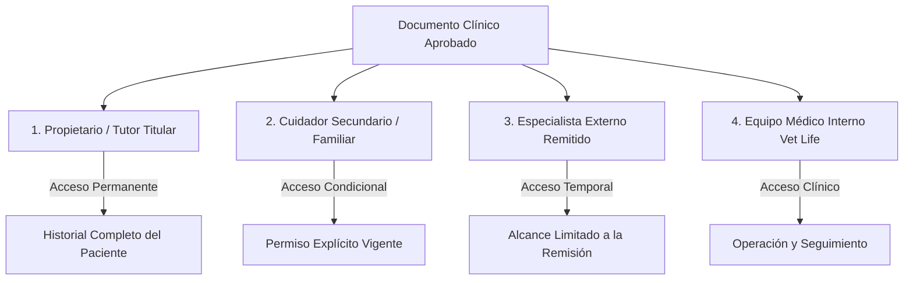

# VET FREEDOM OS — DOCUMENT RECIPIENT AUTHORIZATION
## Modelo de Autorización de Destinatarios, Permisos Granulares y Segregación de Roles

**Proyecto:** VET FREEDOM OS  
**Módulo:** `VET-CORE-13` / Migration 035  
**Dirección Médica:** Dr. Luis Eduardo Ríos  
**Marco Legal:** Ley 576 de 2000 (Colombia), Ley 1581 de 2012 (Habeas Data)

---

## 1. Jerarquía de Destinatarios y Roles

El acceso a documentos clínicos no es universal. El sistema implementa una matriz estricta de autorización basada en cuatro tipos de roles:

---

## 2. Definición Granular de Roles

### 2.1 Propietario / Tutor Titular (`OWNER`)
- **Titularidad Legal:** Es la persona natural o jurídica registrada en el contrato de prestación de servicios veterinarios de Vet Life.
- **Alcance de Derechos:**
  - Visualización y descarga ilimitada de todos los documentos clínicos de sus mascotas registradas.
  - Facultad exclusiva de autorizar o revocar accesos a cuidadores secundarios.
  - Recepción automática de notificaciones de nuevos documentos vía WhatsApp.
  - Ejercicio de derechos de Habeas Data (solicitud de copias, rectificación de datos biográficos).

### 2.2 Cuidador Secundario (`CAREGIVER`)
- **Definición:** Persona designada por el titular para recibir a la veterinaria en el domicilio o administrar medicaciones (hijo, paseador, administrador de finca, familiar).
- **Alcance de Derechos:**
  - Solo puede acceder a documentos autorizados explícitamente mediante `document_recipient_permissions`.
  - Permisos condicionados a temporalidad (`valid_until`) y estado activo (`is_revoked = false`).
  - **Revocabilidad Inmediata:** Si el titular remueve al cuidador en Lovable/Supabase, todos los enlaces activos y tokens de acceso asociados se invalidan al instante.

### 2.3 Especialista Externo (`EXTERNAL_SPECIALIST`)
- **Definición:** Centro médico, laboratorio clínico o especialista veterinario independiente (cardiólogo, oncólogo, ecografista) al que se remite el caso.
- **Alcance de Derechos:**
  - Acceso restringido exclusivamente a los documentos anexos a la remisión activa (`VET-CORE-11`).
  - Sin acceso al historial general ni a datos financieros del cliente.
  - Vigencia acotada a la atención interconsulta (por defecto 15 a 30 días post-remisión).

### 2.4 Staff Interno y Veterinarios (`STAFF` / `VET`)
- **Médico Tratante (Dr. Luis Ríos):** Creación, modificación en borrador, firma y aprobación con matrícula COMVEZCOL.
- **Asistentes Operativos:** Solo lectura de estado de entrega y gestión logística; imposibilidad técnica de firmar o alterar diagnósticos.

---

## 3. Matriz de Operaciones Permitidas

| Rol | Ver Borrador | Ver Aprobado | Descargar PDF | Compartir Enlace | Firmar Documento | Revocar Acceso |
| :--- | :---: | :---: | :---: | :---: | :---: | :---: |
| **STAFF (Vet COMVEZCOL)** | SÍ | SÍ | SÍ | SÍ | **SÍ** | SÍ |
| **STAFF (Operativo)** | NO | SÍ | SÍ | SÍ | NO | NO |
| **OWNER (Tutor)** | NO | SÍ | SÍ | SÍ | NO | SÍ (a cuidadores) |
| **CAREGIVER (Activo)** | NO | SÍ | SÍ (si permitido) | NO | NO | NO |
| **CAREGIVER (Revocado)**| **NO** | **NO** | **NO** | **NO** | NO | NO |
| **EXTERNAL_SPECIALIST** | NO | SÍ (solo remisión) | SÍ (solo remisión) | NO | NO | NO |

---

## 4. Reglas de Validación en Stored Procedures

La función `authorize_document_recipient` valida las siguientes invariantes antes de emitir cualquier permiso:
1. El documento debe existir y no estar marcado como eliminado.
2. Si el rol es `CAREGIVER`, se valida que no exista un registro previo de revocación por conflicto entre partes.
3. El tiempo de expiración `valid_until` no puede ser en el pasado.
4. Toda modificación en la matriz de destinatarios escribe un registro en `document_audit`.
