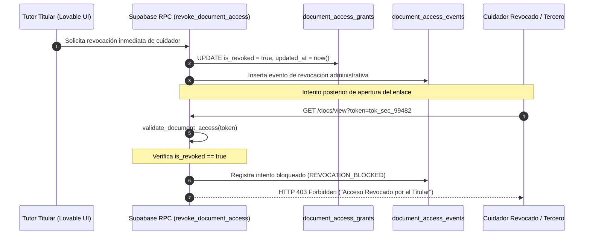

# VET FREEDOM OS — DOCUMENT ACCESS REVOCATION
## Protocolos de Revocación de Accesos Documentales, Desautorización de Cuidadores y Mitigación de Fuga de Información

**Proyecto:** VET FREEDOM OS  
**Módulo:** `VET-CORE-13`  
**Dirección Médica:** Dr. Luis Eduardo Ríos  
**Prioridad:** CRÍTICA (Seguridad y Privacidad del Paciente)

---

## 1. Escenarios de Revocación

Existen cuatro circunstancias operativas y legales que desencadenan la revocación inmediata de un documento o enlace emitido:

1. **Desvinculación / Revocación de Cuidador (`CAREGIVER_REVOCATION`):**
   - El tutor titular notifica que una persona previamente autorizada (familiar, empleado, paseador) ya no tiene custodia del paciente.
   - Todo permiso otorgado en `document_recipient_permissions` pasa a `is_revoked = true`.
2. **Reemplazo / Corrección Clínica de Documento (`SUPERSEDED_VERSION`):**
   - Se emite una versión enmendada (v2) de un informe médico o fórmula terapéutica para corregir una dosificación o diagnóstico. La versión previa v1 debe cesar su distribución y marcarse como obsoleta.
3. **Fuga Sospechosa o Enlace Compartido en Canales No Autorizados (`BREACH_CONTAINMENT`):**
   - Se detectan múltiples accesos anómalos desde diversas direcciones IP o geolocalizaciones incongruentes.
4. **Activación del Protocolo de Duelo (`BEREAVEMENT_LOCK`):**
   - Ante el fallecimiento de un paciente, los enlaces comerciales o recordatorios se congelan para evitar traumatismos emocionales a la familia.

---

## 2. Flujo Operativo de Revocación en Tiempo Real



---

## 3. Implementación del Procedimiento de Revocación

El procedimiento almacenado `revoke_document_access` actúa de forma atómica en PostgreSQL:

```sql
CREATE OR REPLACE FUNCTION public.revoke_document_access(
    p_grant_id UUID,
    p_reason TEXT DEFAULT 'REVOKED_BY_USER'
)
RETURNS JSONB
LANGUAGE plpgsql
SECURITY DEFINER
SET search_path = public
AS $$
DECLARE
    v_grant RECORD;
    v_doc_id UUID;
BEGIN
    -- 1. Obtener la concesión
    SELECT dag.*, dv.document_id INTO v_grant
    FROM document_access_grants dag
    JOIN document_versions dv ON dv.id = dag.version_id
    WHERE dag.id = p_grant_id;

    IF NOT FOUND THEN
        RETURN jsonb_build_object('success', false, 'error', 'GRANT_NOT_FOUND');
    END IF;

    -- 2. Marcar como revocada
    UPDATE document_access_grants
    SET is_revoked = true,
        updated_at = now()
    WHERE id = p_grant_id;

    -- 3. Registrar auditoría forense
    INSERT INTO document_access_events (
        grant_id,
        event_type,
        client_ip,
        user_agent,
        referrer,
        occurred_at
    ) VALUES (
        p_grant_id,
        'REVOCATION_APPLIED',
        NULL,
        'SYSTEM_SECURITY_RPC',
        p_reason,
        now()
    );

    -- 4. Registrar en el log inmutable
    INSERT INTO document_audit (
        document_id,
        action,
        previous_state,
        new_state,
        performed_by,
        performed_at
    ) VALUES (
        v_grant.document_id,
        'ACCESS_GRANT_REVOKED',
        jsonb_build_object('grant_id', p_grant_id, 'is_revoked', false),
        jsonb_build_object('grant_id', p_grant_id, 'is_revoked', true, 'reason', p_reason),
        auth.uid(),
        now()
    );

    RETURN jsonb_build_object(
        'success', true,
        'grant_id', p_grant_id,
        'revoked_at', now()
    );
END;
$$;
```

---

## 4. Garantía de Cancelación de Entregas en Tránsito en n8n

Si una solicitud de entrega se encuentra encolada en `VET-CORE-13` para despacho posterior y se invoca la revocación antes de la transmisión por WhatsApp:
1. El nodo de n8n `Evaluate Document Delivery Eligibility` verifica en caliente `caregiver_revoked` y `is_revoked`.
2. Al detectar el estado revocado, conmuta la rama condicional hacia `Log Delivery Suppressed Or Rejected`.
3. El mensaje nunca llega a la cola de `VET-CORE-03`, previniendo la divulgación no autorizada del documento confidencial.
