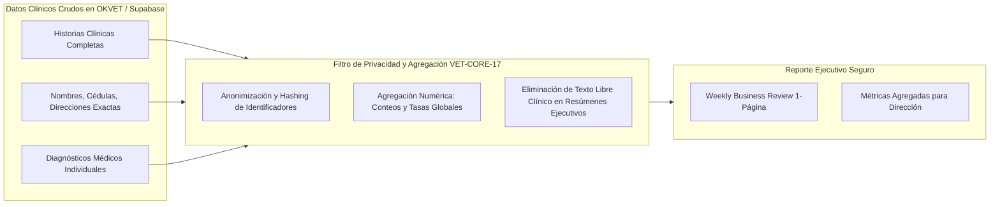

# Privacidad de Datos y Protección de Información Sensible (VET-CORE-17)

**Módulo:** `VET-CORE-17 | WEEKLY REPORTING`  
**Proyecto:** VET FREEDOM OS — Vet Life: Veterinaria a Domicilio  
**Dirección Médica:** Dr. Luis Eduardo Ríos  
**Dirección Estratégica:** Alpha Vision Method  
**Entorno:** DEVELOPMENT / QA  
**Fecha:** 2026-11-21  

---

## 1. Principio de Minimización de Datos en Informes Ejecutivos

> **El reporte ejecutivo semanal analiza patrones agregados, capacidades y salud del negocio; JAMÁS expone expedientes clínicos íntegros ni datos personales no anonimizados.**

Conforme a la Ley Estatutaria 1581 de 2012 (Habeas Data Colombia) y las directrices del Consejo Profesional de Medicina Veterinaria y Zootecnia (COMVEZCOL), el tratamiento de información en `VET-CORE-17` aplica un estricto filtro de anonimización y agregación.

---

## 2. Reglas Específicas de Protección

1. **No Volcado de Historias Clínicas (T103):** El reporte semanal no incluye evoluciones clínicas, descripciones quirúrgicas detalladas ni notas privadas de consulta. Solo reporta el número agregado de visitas completadas y su estado de cierre documental.
2. **Anonimización en Análisis de Quejas:** En la tabla `executive_recurring_problem_clusters`, las menciones a tutores o mascotas se sustituyen por códigos opacos (`TUTOR_HASH_4821`), preservando la confidencialidad en los análisis estadísticos de satisfacción.
3. **Manejo Seguro de Datos Financieros:** Los números de cuentas bancarias de clientes o tokens de pasarela jamás se almacenan en los snapshots ejecutivos. Únicamente se persisten montos consolidados, referencias de transacción y estados de conciliación.
4. **Prohibición de Exportación de Secretos:** Queda terminantemente prohibido incluir API Keys de WhatsApp, tokens de OpenAI/Anthropic, claves privadas de Supabase o credenciales de OKVET en los payloads o logs del sistema.
