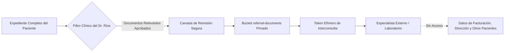

# VET FREEDOM OS — EXTERNAL DOCUMENT ACCESS
## Arquitectura de Acceso Seguro para Especialistas Externos, Laboratorios y Centros de Diagnóstico

**Proyecto:** VET FREEDOM OS  
**Módulo:** `VET-CORE-13`  
**Integración:** `VET-CORE-11` (Specialist Coordination)  
**Dirección Médica:** Dr. Luis Eduardo Ríos  
**Estándar:** Acceso Clínico Perimetral con Principio de Menor Privilegio

---

## 1. Contexto Clínico de Interconsulta

Cuando un paciente atendido a domicilio por Vet Life requiere una remisión a un especialista externo (ej. ecografía abdominal especializada, valoración cardiológica, tomografía o cirugía de tejidos blandos), el especialista necesita acceder a:
1. La carta de remisión formal suscrita por el Dr. Luis Ríos con matrícula COMVEZCOL.
2. Los resultados previos de exámenes de laboratorio y paraclínicos pertinentes.
3. El resumen de anamnesis relevante.

**Riesgo de Seguridad a Mitigar:** El especialista externo **no debe** tener acceso al expediente completo no relacionado, a los datos financieros del cliente, a las direcciones residenciales privadas ni a los historiales de otras mascotas de la familia.

---

## 2. Aislamiento y Canasta de Documentos de Remisión

El acceso de terceros se gestiona a través de una "Canasta de Documentos de Remisión" (`referral_document_package`):

---

## 3. Reglas de Acceso para Especialistas Externos

1. **Acreditación Previa del Especialista:** El centro o profesional debe estar registrado en el directorio auditado de `specialists` de `VET FREEDOM OS`.
2. **Acceso Acotado en el Tiempo:**
   - La validez del token de acceso para especialistas es de **15 días calendario** a partir de la emisión de la orden de remisión.
   - Si la cita se pospone, el Dr. Luis Ríos puede extender el grant de forma manual desde el portal Lovable.
3. **Restricción de Redescarga:**
   - Se fija un límite máximo de 5 descargas (`max_downloads = 5`).
   - Cada intento de visualización o descarga registra la IP del especialista, User-Agent y timestamp en `document_access_events`.
4. **Cierre de Ciclo e Ingesta de Contra-Referencia:**
   - El especialista puede utilizar un enlace seguro de contra-remisión para cargar el informe diagnóstico definitivo (PDF/DICOM).
   - El archivo subido entra como borrador en `referral-documents` y debe ser revisado y aprobado por el Dr. Luis Ríos antes de incorporarse a la historia clínica principal del paciente.

---

## 4. Auditoría Forense y Trazabilidad

Todo acceso externo genera un rastro que responde a las preguntas de seguridad:
- **¿Quién accedió?** Nombre y credenciales del especialista externo registrado.
- **¿A qué documentos específicos accedió?** IDs y versiones exactas de las cartas e informes.
- **¿Desde dónde y cuándo?** Dirección IP geolocalizada y fecha/hora exacta.
- **¿Hubo intentos de acceso fuera del periodo de gracia?** Identificados con evento `EXPIRED_BLOCKED` en el panel de seguridad de Lovable.
