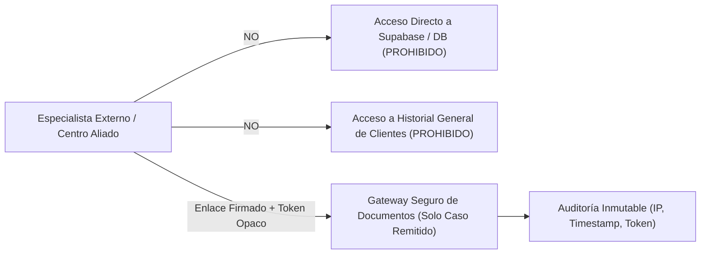

# VET FREEDOM OS — EXTERNAL SPECIALIST ACCESS SECURITY
## Modelo de Seguridad, Aislamiento y Control de Acceso para Especialistas y Centros Aliados
**Módulo:** VET-CORE-11 | SPECIALIST COORDINATION  
**Dirección Médica:** Dr. Luis Eduardo Ríos  
**Entorno:** DEVELOPMENT / QA  

---

## 1. Principio de Mínimo Privilegio para Terceros

Los médicos especialistas externos y los centros de diagnóstico **NO** poseen cuentas directas con permisos de consulta en la base de datos de Vet Freedom OS ni acceso a la interfaz administrativa de Lovable.

---

## 2. Salvaguardas de Seguridad para Especialistas Externos

1. **Tokens Opacos Desacoplados:** El especialista no accede mediante UUIDs de base de datos ni identificadores predecibles. Recibe una URL firmada con un token criptográfico generado aleatoriamente (`specialist_document_access_grants.access_token`).
2. **Alcance Estrictamente Limitado:** El token permite únicamente la visualización y descarga del resumen clínico del paciente específico remitido y durante el período previo a la consulta.
3. **Expiración Automática:** Los enlaces expiran a las 72 horas de su generación o al consumarse la cita.
4. **Revocación Inmediata:** Si el tutor cancela la cita, cambia de especialista o se revoca la remisión, el token se invalida instantáneamente mediante `is_revoked = true`.
5. **Auditoría de Descarga:** Cada acceso registra la dirección IP de origen, User-Agent, fecha/hora y bytes descargados en `specialist_document_access_audit`.
6. **Acuerdo de Confidencialidad y Hábeas Data:** Los especialistas registrados en `specialist_profiles` deben contar con verificación previa de identidad profesional y adhesión a las normas colombianas de protección de datos personales (Ley 1581 de 2012).
