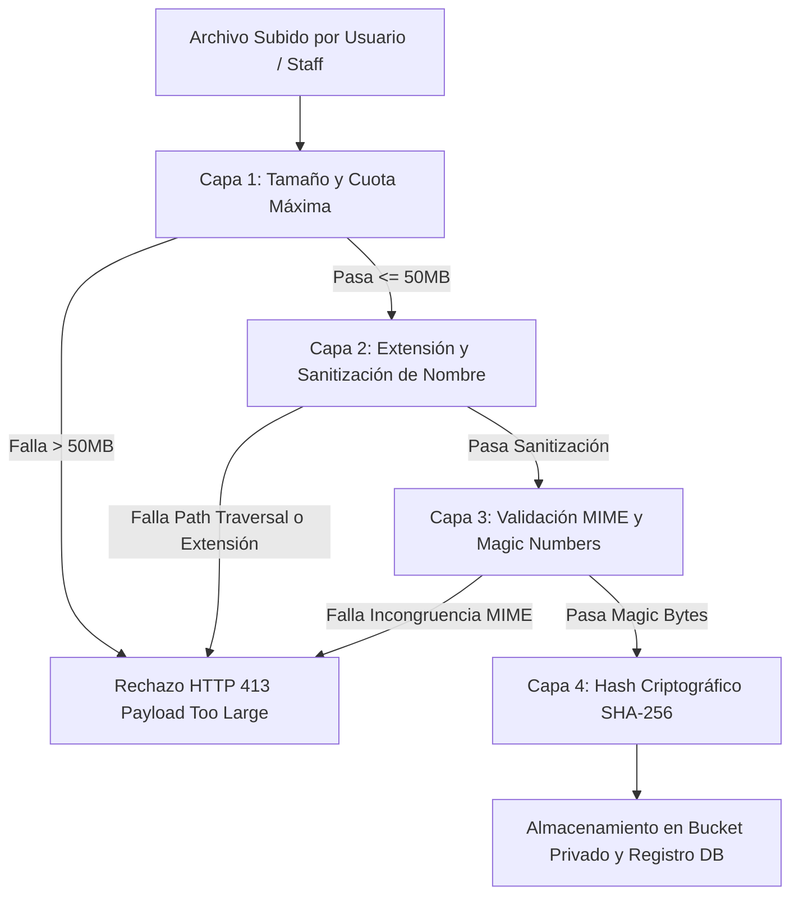

# VET FREEDOM OS — FILE UPLOAD VALIDATION
## Estándar de Validación Estricta de Carga de Archivos, Sanitización, Cuotas e Integridad Criptográfica

**Proyecto:** VET FREEDOM OS  
**Módulo:** `VET-CORE-13`  
**Dirección Médica:** Dr. Luis Eduardo Ríos  
**Vulnerabilidades Mitigadas:** OWASP File Upload Vulnerabilities (Malicious Executables, Zip Bombs, MIME Spoofing, Path Traversal, SSRF)

---

## 1. Reglas de Validación de Entrada

Antes de que un archivo sea admitido en el bucket privado o registrado en la base de datos, debe superar un pipeline de validación en cuatro capas:

---

## 2. Capas del Pipeline de Validación

### Capa 1: Validación de Tamaño y Cuotas de Almacenamiento
- **Límite Estricto por Archivo:** 50 MB (`52,428,800 bytes`).
- **Límite por Consulta Post-Visita:** Máximo acumulado de 150 MB por expediente de consulta.
- Si un archivo excede el tamaño, la función `request_document_upload` rechaza la petición con la excepción:  
  `'File size exceeds maximum allowed limit of 50MB'`.

### Capa 2: Sanitización de Nombres y Protección de Rutas
- **Prevención de Directory Traversal:** Se rechaza cualquier nombre que contenga `../`, `..\`, secuencias nulas `%00` o caracteres de control ASCII.
- **Normalización Canónica:** Los nombres de archivo son sanitizados a minúsculas, reemplazando espacios y caracteres no alfanuméricos por guiones bajos:
  `nombre_sanitizado = regexp_replace(lower(filename), '[^a-z0-9._-]', '_', 'g')`
- **Ruta Determinista:** El storage path es forzado por el sistema:  
  `records/{document_id}/v{version_number}/{sanitized_filename}`.

### Capa 3: Validación de Tipo MIME y Magic Numbers (Firmas Binarias)
La extensión de un archivo puede ser falsificada fácilmente (ej. renombrar `virus.exe` a `informe.pdf`). Por lo tanto, el sistema valida la concordancia estricta entre la extensión, el MIME declarado y los primeros bytes del archivo (Magic Bytes):

| Tipo de Archivo | Extensión Permitida | MIME Type Permitido | Magic Bytes Requeridos (Hex) |
| :--- | :--- | :--- | :--- |
| **Documento PDF** | `.pdf` | `application/pdf` | `25 50 44 46` (`%PDF-`) |
| **Imagen JPEG** | `.jpg`, `.jpeg` | `image/jpeg` | `FF D8 FF` |
| **Imagen PNG** | `.png` | `image/png` | `89 50 4E 47 0D 0A 1A 0A` |
| **Imagen Médica DICOM** | `.dcm` | `application/dicom` | Offset 128: `44 49 43 4D` (`DICM`) |

*Cualquier archivo con discordancia entre extensión y cabecera binaria es rechazado inmediatamente con error `CORRUPTED_OR_DISCORDANT_FILE`.*

### Capa 4: Verificación Criptográfica SHA-256
- El cliente o el servicio que realiza la subida debe calcular el hash SHA-256 del binario y transmitirlo a la RPC `finalize_document_upload`.
- El backend recalcula el hash sobre el binario almacenado en Supabase Storage.
- Si ambos hashes coinciden: el documento se marca con `validation_status = 'VALIDATED'`.
- Si difieren: el archivo se purga del bucket y el registro se marca con `validation_status = 'REJECTED_INTEGRITY_MISMATCH'`.

---

## 3. Manejo de Errores y Registro de Seguridad

Todo intento de subida fallida o maliciosa se registra en la tabla `document_audit` con el nivel de severidad `SECURITY_ALERT`, capturando la IP de origen y bloqueando temporalmente el endpoint del cliente infractor mediante rate limiting defensivo.
