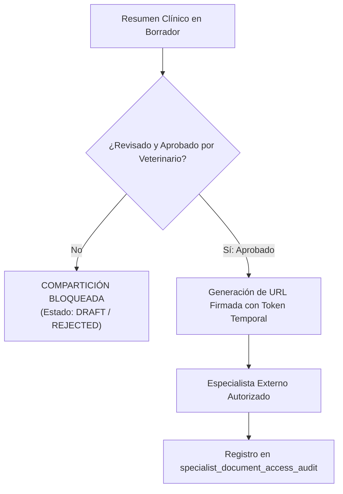

# VET FREEDOM OS — REFERRAL DOCUMENT ACCESS SECURITY
## Almacenamiento Seguro, Aprobación Veterinaria y Control de Acceso a Documentos Clínicos
**Módulo:** VET-CORE-11 | SPECIALIST COORDINATION  
**Dirección Médica:** Dr. Luis Eduardo Ríos  
**Bucket de Almacenamiento:** `referral-documents` (Modo: Privado)  

---

## 1. El Bucket Privado `referral-documents`

Todos los documentos intercambiados con especialistas externos (historias clínicas consolidadas, órdenes médicas, resultados de laboratorio, ecografías y radiografías) residen en el bucket privado de Supabase Storage `referral-documents`.

---

## 2. Invariantes de Seguridad Documental

1. **Aprobación Veterinaria Previa:** Un documento en estado `DRAFT` **nunca** puede ser compartido ni expuesto a terceros. Requiere la firma o aprobación del médico veterinario tratante (`document_status = 'APPROVED'`).
2. **Validación Antimalware y Tipos MIME:** Solo se admiten archivos con tipos MIME seguros y extensiones verificadas:
   - `application/pdf`
   - `image/jpeg`
   - `image/png`
   - `application/dicom` (estudios radiológicos)
3. **Enlaces con Vencimiento Estricto:** Las URLs firmadas emitidas tienen una validez máxima de 72 horas. Transcurrido ese plazo, el enlace retorna un error `403 Forbidden`.
4. **Revocación Inmediata:** Si el tutor cancela la remisión o se cambia de especialista asignado, el Stored Procedure o el equipo de coordinación ejecuta la revocación inmediata del token (`is_revoked = true`).
5. **Pista Inmutable de Descarga:** La tabla `specialist_document_access_audit` registra:
   - `grant_id`: Referencia a la autorización emitida.
   - `accessed_at`: Timestamp UTC exacto del acceso.
   - `ip_address`: Dirección IP del visitante.
   - `user_agent`: Identificador del navegador o cliente HTTP.
