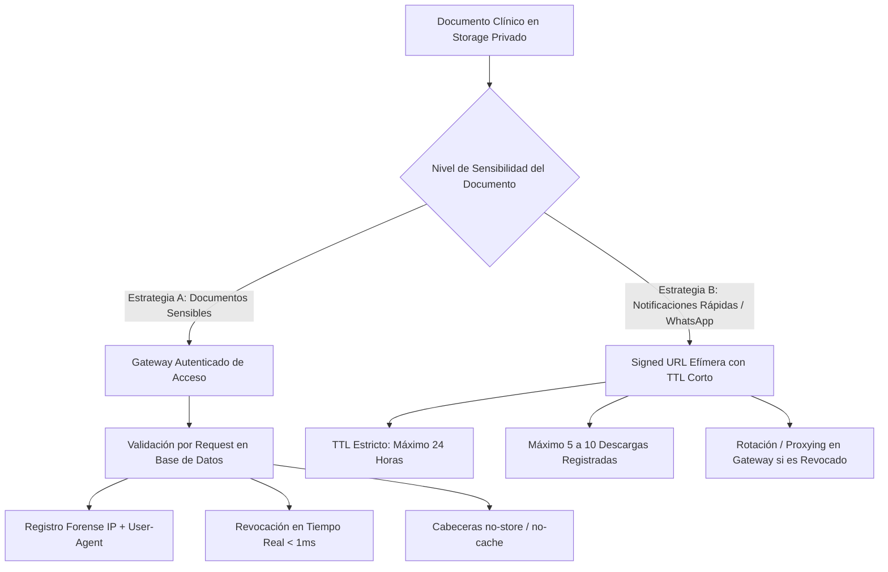

# VET FREEDOM OS — SIGNED URL LIMITATIONS & STRATEGY ANALYSIS
## Análisis Comparativo de Riesgos: Signed URLs Efímeras vs. Gateway Autenticado de Acceso

**Proyecto:** VET FREEDOM OS  
**Módulo:** `VET-CORE-13`  
**Dirección Médica:** Dr. Luis Eduardo Ríos  
**Clasificación de Riesgo:** ALTO (Datos Clínicos Confidenciales)

---

## 1. El Dilema de Seguridad de las Signed URLs de Almacenamiento

En plataformas cloud modernas (AWS S3, Google Cloud Storage, Supabase Storage), las **Signed URLs** son generadas mediante firmas criptográficas HMAC que autorizan el acceso directo a un objeto en el bucket sin requerir sesión activa en la base de datos.

Sin embargo, en el contexto de **Historias Clínicas Veterinarias y Documentos Privados**, las Signed URLs tradicionales introducen vulnerabilidades críticas que deben ser mitigadas mediante controles arquitectónicos estrictos.

### 1.1 Invariante de Seguridad: "Las Signed URLs son Enlaces al Portador (Bearer Links)"
Una vez generada una Signed URL estándar:
1. **Cualquiera en posesión del enlace puede descargar el archivo:** Si el enlace es reenviado a un tercero no autorizado, compartido en redes sociales o indexado por un proxy corporativo, el storage provider servirá el archivo sin verificar la identidad del solicitante.
2. **Imposibilidad de Revocación Selectiva Inmediata:** La mayoría de los motores de storage no permiten invalidar una sola Signed URL específica antes de su tiempo de expiración (TTL), a menos que se roten las claves maestras del bucket o se modifique la ruta del objeto en storage.
3. **Caché en Nodos Intermedios y Navegadores:** Si las cabeceras HTTP de respuesta no fuerzan `Cache-Control: no-store, no-cache, private`, los proxies intermedios o los navegadores compartidos pueden retener copias locales de fórmulas o resultados médicos.

---

## 2. Estrategia Dual de Vet Freedom OS

Para resolver este desafío, `VET-CORE-13` implementa una arquitectura dual de entrega y consumo documental:



---

## 3. Comparativa Técnica de Estrategias

| Criterio | Estrategia A: Gateway Autenticado (`AUTHENTICATED_GATEWAY`) | Estrategia B: Signed URL Efímera (`EPHEMERAL_SIGNED_URL`) |
| :--- | :--- | :--- |
| **Mecanismo de Entrega** | URL apunta al endpoint de la aplicación (`/api/docs/view?token=...`) | URL apunta directamente al CDN/Storage de Supabase con firma HMAC |
| **Verificación de Identidad** | Se evalúa en tiempo real en la base de datos (`validate_document_access`) | Firma criptográfica validada por el servidor web de Storage |
| **Revocabilidad Inmediata** | **100% Inmediata:** Al marcar `is_revoked = true` en `document_access_grants`, el siguiente request es rechazado | Requiere renombrar el objeto o invalidar a nivel de API Gateway proxy |
| **Control de Frecuencia** | Límite exacto de descargas (`max_downloads`); se bloquea al alcanzarlo | No controlable nativamente sin middleware |
| **Auditoría Forense** | Se registra IP exacta, User-Agent, Referrer y Timestamp en cada petición | Limitada a los logs de infraestructura del proveedor cloud |
| **Cabeceras HTTP de Seguridad** | Inyectadas dinámicamente (`no-store, no-cache, must-revalidate`) | Depende de la configuración fija del bucket |
| **Uso Recomendado en Vet Life** | **Por defecto para:** Historias clínicas, informes ecográficos, remisiones y fórmulas | **Solo para:** Certificados de vacunación y recibos de pago con TTL <= 24h |

---

## 4. Mitigaciones Obligatorias para Estrategia B

Cuando el Dr. Luis Ríos o el sistema autorizan el uso de Estrategia B por conveniencia operativa en WhatsApp:
1. **Tiempo de Vida Máximo de 24 Horas:** Ningún enlace emitido puede superar las 24 horas de validez (`expires_at <= now() + interval '24 hours'`).
2. **Monitoreo de Acceso en Tiempo Real:** El enlace enviado al tutor en WhatsApp es en realidad un link enmascarado del Gateway de Vet Life (`https://vetlife.com.co/docs/g/{token}`) que redirige de inmediato a la Signed URL temporal tras registrar la auditoría y verificar que el cuidador no haya sido revocado en el milisegundo anterior.
3. **Inyección de Cabeceras Anti-Cache:** Toda respuesta servida a través del Gateway incluye obligatoriamente:
   ```http
   Cache-Control: no-store, no-cache, must-revalidate, max-age=0
   Pragma: no-cache
   Expires: 0
   X-Content-Type-Options: nosniff
   Content-Disposition: inline; filename="documento_seguro.pdf"
   ```
