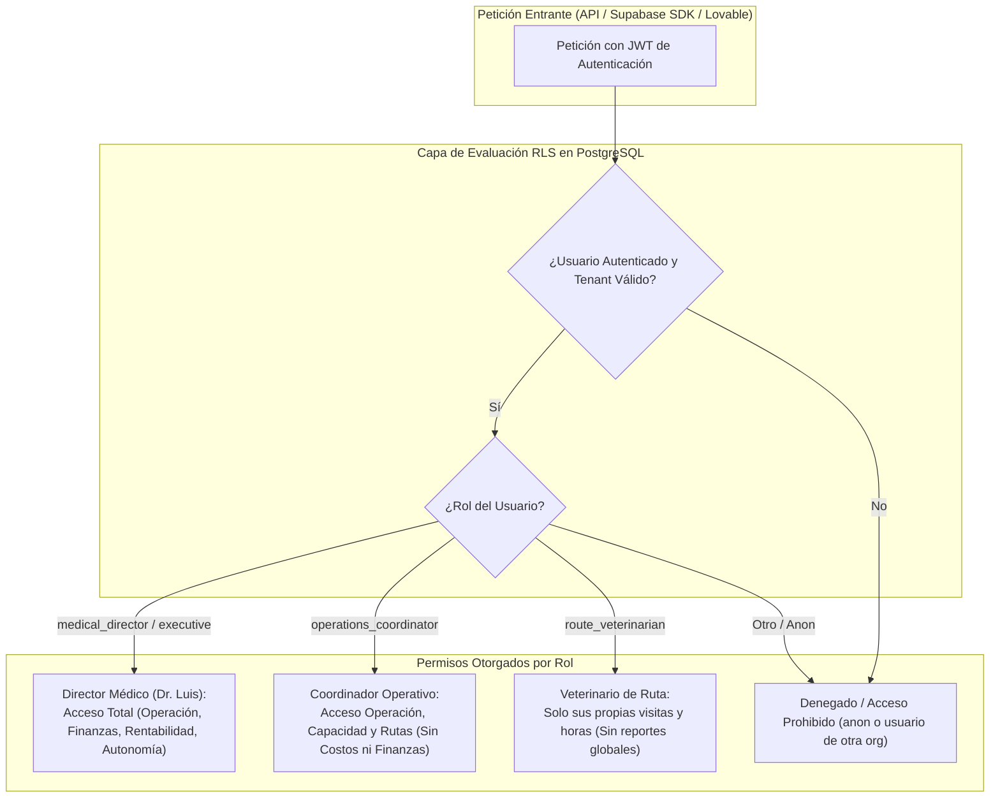

# Modelo de Seguridad RLS y Control de Acceso Semanal (VET-CORE-17)

**Módulo:** `VET-CORE-17 | WEEKLY REPORTING`  
**Proyecto:** VET FREEDOM OS — Vet Life: Veterinaria a Domicilio  
**Dirección Médica:** Dr. Luis Eduardo Ríos  
**Dirección Estratégica:** Alpha Vision Method  
**Entorno:** DEVELOPMENT / QA  
**Fecha:** 2026-11-21  

---

## 1. Política de Aislamiento Multi-Tenant y RBAC

El sistema de reportería ejecutiva semanal almacena los secretos comerciales y financieros más críticos de Vet Life. Por ello, la migración 038 habilitó forzosamente Row-Level Security (`ALTER TABLE ... ENABLE ROW LEVEL SECURITY; ALTER TABLE ... FORCE ROW LEVEL SECURITY;`) en las 14 tablas del módulo.



---

## 2. Definición Formal de Políticas RLS

### A. Política Multi-Tenant Aislada
Toda consulta filtra por `organization_id` verificado mediante los metadatos del JWT del usuario:
```sql
CREATE POLICY "weekly_reports_tenant_isolation" ON public.executive_weekly_reports
FOR ALL TO authenticated
USING (
  organization_id = (auth.jwt() -> 'app_metadata' ->> 'organization_id')::uuid
)
WITH CHECK (
  organization_id = (auth.jwt() -> 'app_metadata' ->> 'organization_id')::uuid
);
```

### B. Segregación Financiera Estricta (T102)
- Los coordinadores operativos o personal administrativo sin el claim `financial_viewer` tienen **acceso denegado por RLS** sobre la tabla `executive_profitability_analyses`.
- Si un usuario no autorizado intenta hacer `SELECT * FROM executive_profitability_analyses`, PostgreSQL retorna 0 filas o un error `42501 (insufficient_privilege)`.

### C. Revocación de Privilegios a Anónimos
- Ninguna de las 6 RPCs (`resolve_weekly_period`, `claim_weekly_report_generation`, etc.) puede ser ejecutada por el rol `anon` ni por `PUBLIC`.
- Los permisos de ejecución fueron explícitamente revocados y asignados únicamente a `authenticated` y `service_role`.
