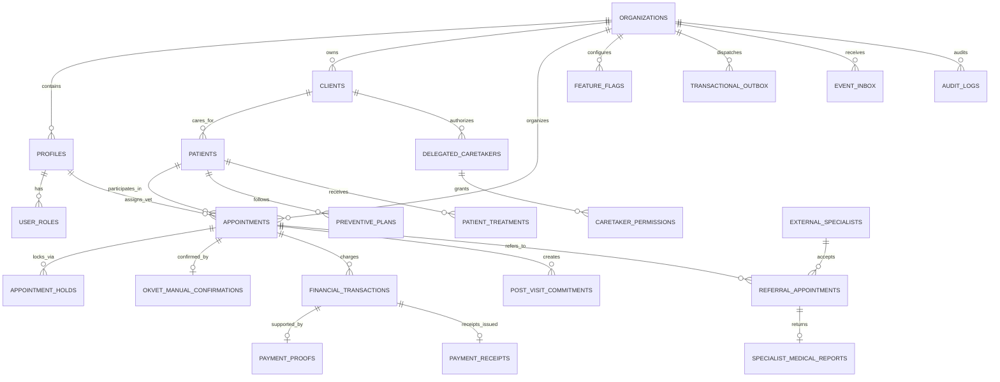

# VET FREEDOM OS — ENTITY RELATIONSHIP MAP
## Mapa de Entidades y Relaciones Clave del Backend
**Proyecto:** VET FREEDOM OS  
**Empresa:** Vet Life — Veterinaria a Domicilio  
**Base de Datos:** PostgreSQL 17.12.0  
**Fecha:** 2026-11-21  

---

## 1. DIAGRAMA ER CONCEPTUAL PRINCIPAL

---

## 2. DETALLE DE RELACIONES CLAVE Y CARDINALIDADES

### 2.1 Dominio Cliente - Mascota - Cuidador Delegado
- `clients` (1) <---> (N) `patients`: Relación uno a muchos. Un tutor puede registrar múltiples mascotas. `patient.client_id` es clave foránea obligatoria con `ON DELETE RESTRICT`.
- `clients` (1) <---> (N) `delegated_caretakers`: Relación uno a muchos. Permite delegar responsabilidades sobre una o varias mascotas a un familiar o paseador.
- `delegated_caretakers` (1) <---> (N) `caretaker_permissions`: Permisos detallados (`can_view_records`, `can_authorize_treatments`, `can_schedule_appointments`) con vigencia temporal estricta (`valid_from`, `valid_until`).

### 2.2 Dominio Agendamiento - Concurrencia - OKVET
- `staff_profiles` (1) <---> (N) `appointments`: Un profesional veterinario atiende múltiples citas en su jornada.
- `appointments` (1) <---> (N) `appointment_holds`: Reservas provisionales de 15 minutos creadas atómicamente por `create_appointment_hold()`. Se liberan automáticamente al vencer o al cancelarse.
- `appointments` (1) <---> (1) `okvet_manual_confirmations`: Relación uno a uno obligatoria para transicionar citas a estado `CONFIRMED`. Almacena `okvet_appointment_id`, `confirmation_notes`, `verified_by` y huella de evidencia.

### 2.3 Dominio Interconsulta Médica y Especialistas
- `appointments` (1) <---> (N) `referral_appointments`: Remisiones a especialistas externos generadas durante o tras la consulta general.
- `external_specialists` (1) <---> (N) `referral_appointments`: Profesionales externos que reciben solicitudes de interconsulta según su especialidad y aranceles acordados.
- `referral_appointments` (1) <---> (1) `specialist_medical_reports`: Informe técnico y contrarremisión médica con trazabilidad forense.

### 2.4 Dominio Financiero y Cobranzas
- `appointments` (1) <---> (N) `invoices`: Prefacturas y facturas asociadas a la prestación domiciliaria.
- `invoices` (1) <---> (N) `financial_transactions`: Pagos parciales o totales registrados en moneda oficial (COP).
- `financial_transactions` (1) <---> (1) `payment_proofs`: Imagen o PDF de comprobante bancario cargado a bucket privado.
- `financial_transactions` (1) <---> (1) `payment_receipts`: Recibo formal emitido tras conciliación por el rol Finanzas.

### 2.5 Dominio Mensajería Desacoplada y Auditoría
- `organizations` (1) <---> (N) `transactional_outbox`: Registro durable de eventos para consumo por n8n (`event_type`, `payload`, `status`, `retry_count`).
- `organizations` (1) <---> (N) `event_inbox`: Deduplicación de webhooks externos (`idempotency_key`, `source`, `processed_at`).
- `organizations` (1) <---> (N) `audit_logs`: Trazabilidad inmutable de cualquier inserción, actualización o eliminación en la base de datos.
