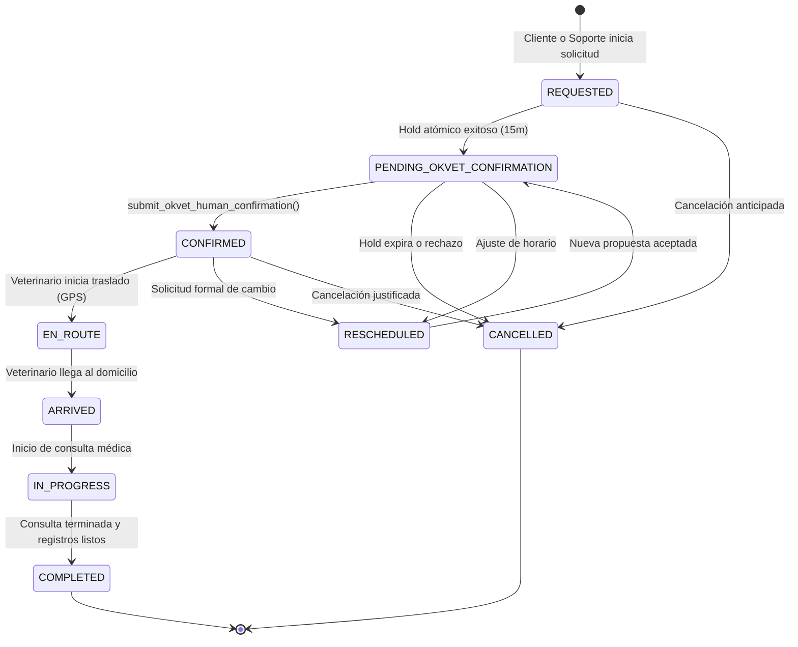
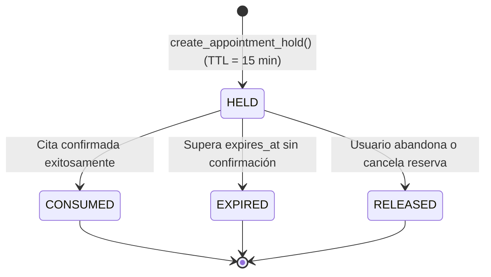
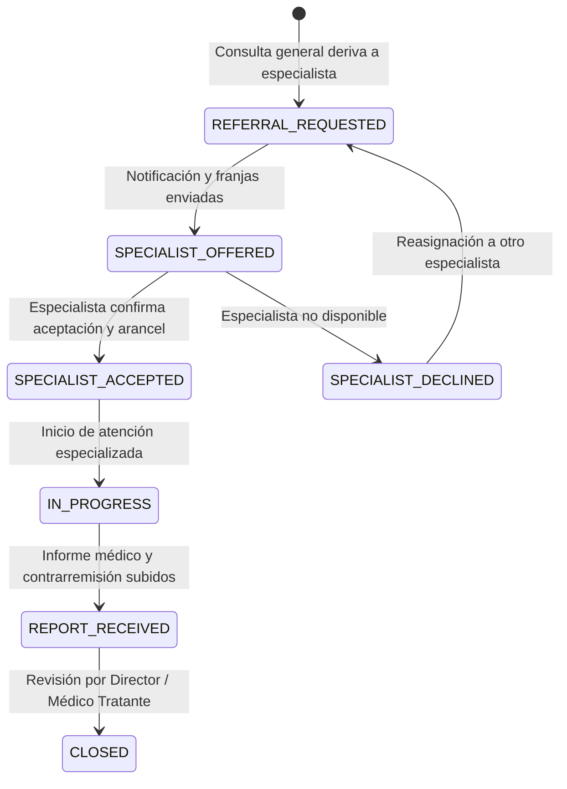
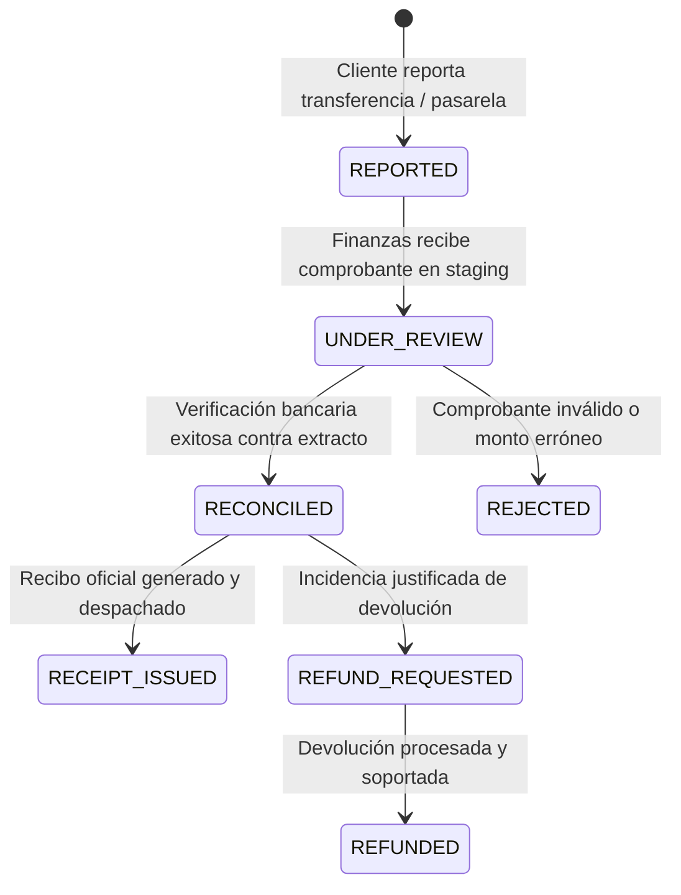

# VET FREEDOM OS — STATE MACHINES SPECIFICATION
## Máquinas de Estados y Transiciones de Negocio en Supabase
**Proyecto:** VET FREEDOM OS  
**Empresa:** Vet Life — Veterinaria a Domicilio  
**Base de Datos:** PostgreSQL 17.12.0  
**Fecha:** 2026-11-21  

---

## 1. MÁQUINA DE ESTADOS DE CITAS DOMICILIARIAS (`appointments`)

El ciclo de vida de una cita médica veterinaria sigue una máquina de estados determinista, gobernada por triggers y validaciones a nivel de base de datos para impedir saltos ilegales.

### Tabla de Transiciones Válidas de Citas
| Estado Origen | Estado Destino Permitido | Actor Autorizado | Precondiciones Obligatorias |
|---------------|--------------------------|-------------------|-----------------------------|
| `REQUESTED` | `PENDING_OKVET_CONFIRMATION` | Sistema / Soporte | Hold provisional activo creado |
| `REQUESTED` | `CANCELLED` | Cliente / Soporte | Motivo de cancelación registrado |
| `PENDING_OKVET_CONFIRMATION` | `CONFIRMED` | Operador Humano (`support`/`director`) | RPC `submit_okvet_human_confirmation` con ID de OKVET y evidencia |
| `PENDING_OKVET_CONFIRMATION` | `CANCELLED` | Soporte / Sistema | Expiración de hold o cliente no confirma |
| `PENDING_OKVET_CONFIRMATION` | `RESCHEDULED` | Soporte / Cliente | Selección de nuevo slot disponible |
| `CONFIRMED` | `EN_ROUTE` | Veterinario Asignado | Fecha y hora de cita vigente; checklist de maletín verificado |
| `EN_ROUTE` | `ARRIVED` | Veterinario Asignado | Coordenadas de llegada registradas |
| `ARRIVED` | `IN_PROGRESS` | Veterinario Asignado | Validación de identidad de mascota en domicilio |
| `IN_PROGRESS` | `COMPLETED` | Veterinario Asignado | Procedimientos completados; compromisos posvisita creados |
| `CONFIRMED` | `NO_SHOW` | Veterinario Asignado | Espera mínima cumplida en domicilio sin respuesta del tutor |

---

## 2. MÁQUINA DE ESTADOS DE RESERVA TEMPORAL (`appointment_holds`)

- **Regla de Concurrencia:** Durante el estado `HELD`, el rango horario del profesional veterinario queda bloqueado para cualquier otra solicitud de reserva.
- **Función de Limpieza:** `expire_stale_appointment_holds()` se ejecuta periódicamente o ante cada consulta de disponibilidad para marcar `is_released = true` en holds que superen `expires_at`.

---

## 3. MÁQUINA DE ESTADOS DE INTERCONSULTAS (`referral_appointments`)

---

## 4. MÁQUINA DE ESTADOS FINANCIERA (`financial_transactions`)

- **Aislamiento:** La transición a `RECONCILED` requiere autorización explícita de un usuario con rol `finance_reconciliation` o `director`.
- **Inmutabilidad:** Una vez en `RECEIPT_ISSUED`, el registro financiero es inmutable; cualquier corrección exige una transacción de ajuste compensatorio.
