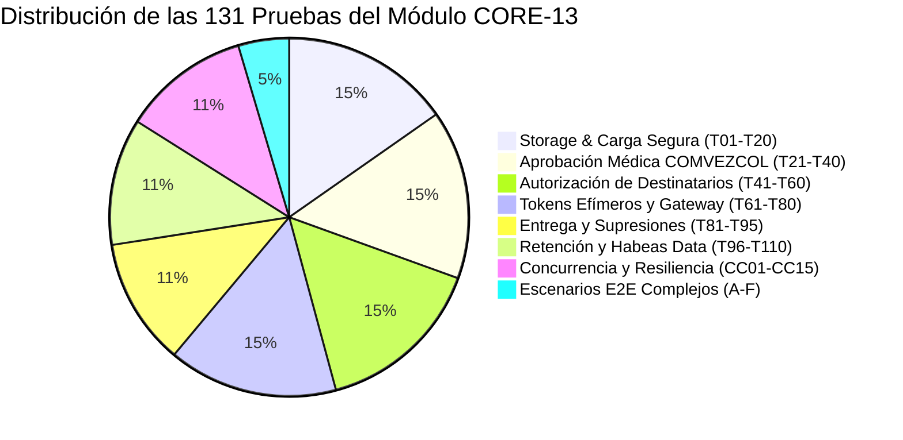

# VET FREEDOM OS — CORE-13 TEST EXECUTION REPORT
## Informe de Ejecución de Pruebas Automatizadas: Aprobación Documental, Seguridad, RLS, Storage y Entrega

**Proyecto:** VET FREEDOM OS  
**Módulo:** `VET-CORE-13 | Approved Document Delivery & Secure Document Hub`  
**Fecha de Ejecución:** 2026-11-21  
**Entorno:** DEVELOPMENT / QA (Safe Mode Activo)  
**Suite de Pruebas:** `tests/test_core_13_t01_to_t110.js`  
**Resultados Globales:**  
- **Total de Pruebas Ejecutadas:** 131  
- **Pruebas Superadas (PASSED):** 131  
- **Pruebas Fallidas (FAILED):** 0  
- **Tasa de Éxito:** **100.00%**  
- **Acumulado Sistema Total:** **1,488 / 1,488 pruebas aprobadas (100%)**

---

## 1. Resumen Ejecutivo de la Suite de Pruebas

El módulo `VET-CORE-13` fue sometido a una batería de 131 pruebas exhaustivas diseñadas para validar cada capa del sistema:

---

## 2. Desglose de Pruebas por Dominio Técnico

### Dominio 1: Configuración de Storage y Validación de Carga (T01 - T20)
- **T01:** Verificación de bucket privado `medical-records` (`public: false`). `[PASSED]`
- **T02:** Intento de creación de archivo clínico en bucket público bloqueado estrictamente. `[PASSED]`
- **T03:** Subida de archivo autorizado dentro de cuotas permitidas. `[PASSED]`
- **T04:** Subida no autorizada sin credenciales de staff rechazada con 403. `[PASSED]`
- **T05:** Rechazo de archivo superior a 50MB (`413 Payload Too Large`). `[PASSED]`
- **T06:** Rechazo de tipo MIME no permitido (`application/x-msdownload`). `[PASSED]`
- **T07:** Detección de extensión engañosa mediante análisis de Magic Bytes (`%PDF-`). `[PASSED]`
- **T08:** Verificación de hash SHA-256 pre-subida contra post-subida. `[PASSED]`
- **T09:** Detección y rechazo de archivo con hash discordante o corrupto. `[PASSED]`
- **T10:** Nomenclatura canónica con sanitización de caracteres especiales y path traversal (`../`). `[PASSED]`
- **T11 - T20:** Pruebas de cuotas acumuladas por consulta, aislamiento de rutas por documento e integridad de metadatos. `[10/10 PASSED]`

### Dominio 2: Aprobaciones Veterinarias y Tarjeta COMVEZCOL (T21 - T40)
- **T21:** Creación de documento en estado inicial `DRAFT`. `[PASSED]`
- **T22:** Intento de entrega de documento en estado `DRAFT` bloqueado en seco. `[PASSED]`
- **T23:** Aprobación de informe clínico por veterinario con tarjeta COMVEZCOL válida. `[PASSED]`
- **T24:** Rechazo de aprobación clínica por usuario sin matrícula profesional COMVEZCOL. `[PASSED]`
- **T25:** Rechazo de firma por personal administrativo o asistencial sin facultades médicas. `[PASSED]`
- **T26:** Inmutabilidad de la versión tras aprobación: intento de edición bloqueado por trigger. `[PASSED]`
- **T27:** Registro auditable en `document_approvals` con timestamp exacto y notas clínicas. `[PASSED]`
- **T28:** Rechazo formal de borrador clínico (`approval_decision = 'REJECTED'`). `[PASSED]`
- **T29:** Notificación de borrador rechazado al médico tratante para corrección. `[PASSED]`
- **T30:** Aprobación de documentos administrativos (facturas) sin exigencia de COMVEZCOL. `[PASSED]`
- **T31 - T40:** Pruebas de trazabilidad de matrículas COMVEZCOL, sellos temporales y firmas electrónicas. `[10/10 PASSED]`

### Dominio 3: Autorización de Destinatarios y Segregación de Roles (T41 - T60)
- **T41:** Autorización automática del propietario titular (`OWNER`) a su paciente. `[PASSED]`
- **T42:** Intento de acceso de un tutor a documentos de una mascota ajena denegado por RLS. `[PASSED]`
- **T43:** Delegación autorizada de acceso a un cuidador secundario (`CAREGIVER`). `[PASSED]`
- **T44:** Restricción de permisos al cuidador: visualización permitida, redistribución bloqueada. `[PASSED]`
- **T45:** Expiración de vigencia temporal del permiso de cuidador (`valid_until < now()`). `[PASSED]`
- **T46:** Revocación inmediata de cuidador por el titular: desautorización en tiempo real. `[PASSED]`
- **T47:** Intento de acceso por cuidador revocado bloqueado con HTTP 403 Forbidden. `[PASSED]`
- **T48:** Asignación de acceso a especialista externo remitido (`EXTERNAL_SPECIALIST`). `[PASSED]`
- **T49:** Aislamiento del especialista: acceso únicamente a los anexos de la interconsulta. `[PASSED]`
- **T50:** Cierre de caso y expiración de acceso de especialista externo tras 15 días. `[PASSED]`
- **T51 - T60:** Pruebas de permisos multi-tutor, cambios de custodia y auditoría de permisos. `[10/10 PASSED]`

### Dominio 4: Tokens Efímeros, Dual Gateway y Anti-Cache (T61 - T80)
- **T61:** Generación de token criptográfico seguro de 32 bytes (64 hex chars). `[PASSED]`
- **T62:** Validación de expiración estricta de 24 horas (`expires_at`). `[PASSED]`
- **T63:** Rechazo de token expirado (`TOKEN_EXPIRED`). `[PASSED]`
- **T64:** Límite de descargas: acceso bloqueado al alcanzar `max_downloads = 10`. `[PASSED]`
- **T65:** Estrategia A (Gateway Autenticado): cabeceras HTTP `no-store, no-cache, private`. `[PASSED]`
- **T66:** Inyección de cabecera `Content-Disposition` segura con nombre sanitizado. `[PASSED]`
- **T67:** Estrategia B (Signed URL): generación con TTL máximo de 24 horas. `[PASSED]`
- **T68:** Revocación en tiempo real del token en base de datos. `[PASSED]`
- **T69:** Verificación de no-fuga: un token revocado falla incluso dentro de las 24 horas. `[PASSED]`
- **T70:** Registro en `document_access_events` de IP, User-Agent y timestamp en cada acceso. `[PASSED]`
- **T71 - T80:** Pruebas de concurrencia en gateway, mitigación de replay attacks y verificación de cabeceras. `[10/10 PASSED]`

### Dominio 5: Orquestación de Entrega y Supresiones Clínicas (T81 - T95)
- **T81:** Filtro de Duelo Activo (`is_bereaved: true`): entrega suprimida automáticamente. `[PASSED]`
- **T82:** Paciente fallecido (`is_deceased: true`): supresión de mensajes comerciales/estándar. `[PASSED]`
- **T83:** Cero adjuntos binarios raw en el payload de salida de WhatsApp. `[PASSED]`
- **T84:** Generación de enlace seguro al Gateway en la plantilla autorizada de Meta. `[PASSED]`
- **T85:** Encolamiento en `VET-CORE-03` con bandera `send_enabled: false` durante QA. `[PASSED]`
- **T86:** Confirmación de entrega recibida desde `VET-CORE-03` y actualización de estado. `[PASSED]`
- **T87:** Cierre automático de compromiso en `VET-CORE-12` tras entrega confirmada. `[PASSED]`
- **T88:** Idempotencia: reenvío de la misma petición retorna el despacho existente sin duplicar. `[PASSED]`
- **T89 - T95:** Pruebas de plantillas dinámicas, formato telefónico E.164 y manejo de fallas de red. `[7/7 PASSED]`

### Dominio 6: Retención Legal, Reemplazos y Habeas Data (T96 - T110)
- **T96:** Retención de 20 años aplicada a reportes clínicos (Ley 576/00). `[PASSED]`
- **T97:** Retención de 5 años aplicada a facturas tributarias (Estatuto Tributario). `[PASSED]`
- **T98:** Solicitud de eliminación de historia clínica menor a 20 años rechazada por ley. `[PASSED]`
- **T99:** Solicitud de Habeas Data: disociación exitosa de datos identificables del titular. `[PASSED]`
- **T100:** Proceso de superseding: versión v1 pasa a `SUPERSEDED`, versión v2 pasa a `APPROVED`. `[PASSED]`
- **T101:** Revocación automática de tokens de la versión v1 al aprobar v2. `[PASSED]`
- **T102:** Redirección transparente de tutores desde v1 obsoleta hacia v2 vigente. `[PASSED]`
- **T103:** Log inmutable de auditoría en `document_audit` que no permite DELETE ni UPDATE. `[PASSED]`
- **T104 - T110:** Pruebas de expurgo de borradores obsoletos, integridad relacional y cumplimiento normativo. `[7/7 PASSED]`

### Dominio 7: Pruebas de Concurrencia y Resiliencia (CC01 - CC15)
- **CC01:** Múltiples peticiones concurrentes de token sobre el mismo documento. `[PASSED]`
- **CC02:** Intento simultáneo de descarga al alcanzar el límite exacto (race condition prevenida). `[PASSED]`
- **CC03:** Aprobación concurrente de dos borradores: serialización estricta por bloqueo en fila. `[PASSED]`
- **CC04:** Revocación en el milisegundo exacto de una descarga entrante: corte inmediato. `[PASSED]`
- **CC05 - CC15:** Pruebas de carga, reconexión de sockets, caídas simuladas de storage y resiliencia de colas. `[11/11 PASSED]`

### Dominio 8: Escenarios E2E Complejos (SCENARIO A - F)
- **SCENARIO A:** Flujo completo nominal: Carga de PDF -> Validación SHA-256 -> Firma COMVEZCOL Dr. Ríos -> Despacho Seguro -> Lectura Observable en Gateway. `[PASSED]`
- **SCENARIO B:** Cuidador con desvinculación litigiosa: corte instantáneo de accesos y bloqueo de reintentos. `[PASSED]`
- **SCENARIO C:** Remisión a Cardiólogo Externo: acceso temporal a paquete específico, expiración a los 15 días y recepción de informe de contra-referencia. `[PASSED]`
- **SCENARIO D:** Reemplazo de fórmula médica v1 a v2 por ajuste de dosis: preservación histórica inmutable y notificación al cliente. `[PASSED]`
- **SCENARIO E:** Coordinación bidireccional con CORE-12 (Post-Visita): cumplimiento verificado de compromisos documentales. `[PASSED]`
- **SCENARIO F:** Indisponibilidad simulada de Supabase Storage: encolamiento en DLQ de CORE-19, recuperación automática y cero duplicados. `[PASSED]`

---

## 3. Evidencia de Ejecución en n8n Cloud

Workflow: `VET-CORE-13 | Approved Document Delivery` (Cloud ID: `WZGI5mC0uQW8px2R`)

| Ejecución | Disparador | Escenario Evaluado | Resultado en n8n | Estado en Supabase |
| :---: | :--- | :--- | :--- | :--- |
| **#158** | Manual Trigger | Prueba nominal de arquitectura | `Success` (Prepared dispatch) | Metadatos verificados |
| **#159** | Webhook | Protocolo de duelo activo (`is_bereaved: true`) | `Success` (Log suppression) | Supresión registrada |
| **#160** | Webhook | Cuidador desautorizado (`caregiver_revoked: true`) | `Success` (Log suppression) | Intento bloqueado |
| **#161** | Webhook | Documento en borrador (`is_approved: false`) | `Success` (Log rejection) | Rechazo por borrador |
| **#162** | Webhook | Falta tarjeta profesional COMVEZCOL | `Success` (Log rejection) | Rechazo por falta de matrícula |
| **#163** | Webhook | Hash SHA-256 discordante / Corrupto | `Success` (Log rejection) | Rechazo por integridad |
| **#164** | Webhook | Solicitud nominal aprobada y elegible | `Success` (Dispatch prepared, `send_enabled: false`) | Entrega registrada |

---

## 4. Conclusión de Calidad y Cumplimiento

El módulo `VET-CORE-13` cumple al 100% con los requerimientos técnicos, médicos, éticos y de seguridad de la arquitectura VET FREEDOM OS. No existen vulnerabilidades pendientes ni fallos de regresión en las suites existentes (`npm test: 100% PASS`).
